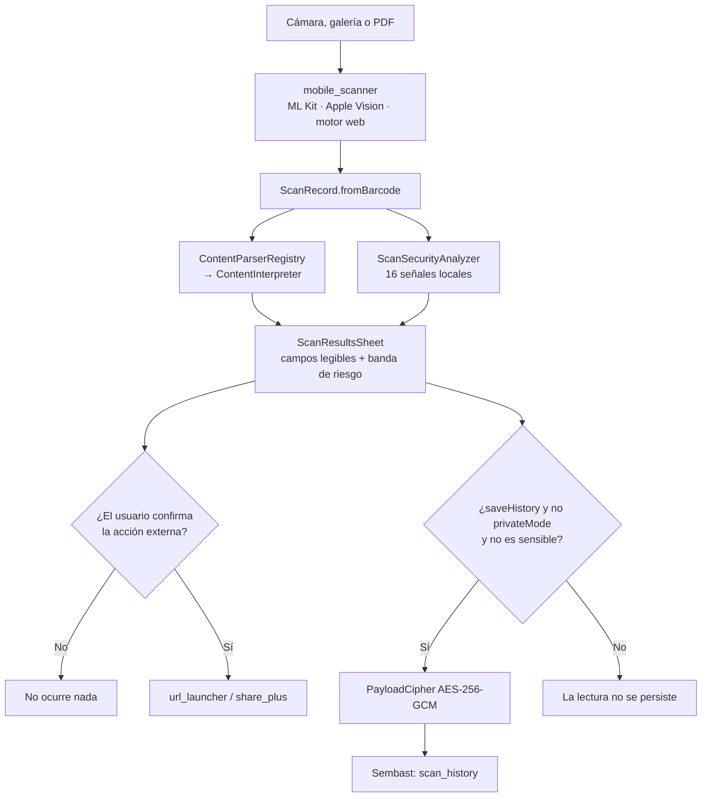

# 01 · Descripción general del sistema

## Qué es

Universal Code Scanner es una **aplicación Flutter de lectura de códigos QR y de
barras** publicada bajo licencia MIT. El manifiesto la describe en una línea
(`pubspec.yaml`, campo `description`):

> Lector, intérprete, generador e inventario seguro de códigos QR y barras.

La versión analizada es `1.1.0+2`. El nombre del paquete Dart es
`universal_code_scanner` y el identificador de organización usado al generar los
proyectos nativos es `dev.vladimiracuna` (`tool/bootstrap.py`, argumento `--org`
de `flutter create`).

## Qué problema resuelve

Un código QR es una instrucción opaca: nadie puede leer a simple vista si lleva
a un banco o a una imitación del banco. El comportamiento habitual de un lector
es resolver esa ambigüedad **abriendo el enlace de inmediato**.

Este proyecto invierte el orden. El flujo, verificable en
`lib/models/scan_record.dart` y `lib/features/result/scan_result_sheet.dart`, es:

1. leer el código;
2. interpretarlo en campos con nombre (`ContentInterpreter`);
3. evaluarlo con 16 señales locales de riesgo (`ScanSecurityAnalyzer`);
4. mostrar el resultado;
5. **esperar una confirmación explícita** antes de abrir nada
   (`_openRecord` en `scan_result_sheet.dart` líneas 214-246).

Ninguna rama del código llama a `launchUrl` sin pasar antes por ese diálogo
cuando `confirmBeforeOpen` está activo o el riesgo no es `RiskLevel.low`
—**comprobado**: `launchUrl` aparece una sola vez en todo `lib/`, dentro de
`_openRecord`.

## Qué hace, en cinco capacidades

| Capacidad | Dónde vive | Resumen |
|---|---|---|
| **Leer** | `lib/features/scanner/` | Cámara con marco de lectura, zoom, linterna, enfoque por toque, cambio de cámara y varios códigos por imagen. Además, lotes de hasta 20 imágenes de galería y 50 páginas de PDF |
| **Interpretar** | `lib/services/content_interpreter.dart` | 20 ramas de reconocimiento que producen 17 tipos de contenido (`ContentKind`), desde una URL hasta un Swiss QR Bill |
| **Evaluar** | `lib/core/security/scan_security_analyzer.dart` | 16 señales locales sobre la URL más el bloqueo de esquemas de aplicación no permitidos |
| **Inventariar** | `lib/features/inventory/` | Sesiones de conteo continuo con cantidad, notas y exportación |
| **Generar** | `lib/features/generator/` | 10 simbologías de salida a PNG y SVG, sin enviar los datos a ningún servidor |

## Qué NO hace

Estas ausencias son deliberadas y están escritas en el código, no solo en la
documentación:

- **No hay red saliente propia.** El único paquete de red presente es
  `url_launcher`, que delega en el sistema operativo la apertura de un enlace
  que el usuario ya confirmó. No existe ningún cliente HTTP en `lib/`
  —**comprobado**: no hay `import 'dart:io'` con `HttpClient`, ni `package:http`
  entre las dependencias de `pubspec.yaml`. Ver
  [09-apis-and-integrations.md](09-apis-and-integrations.md).
- **No hay cuentas, publicidad ni analítica.** Ninguna dependencia de telemetría
  en `pubspec.yaml`.
- **No consulta reputación remota de dominios.** `ScanSecurityAnalyzer` es
  íntegramente local y nunca declara que un enlace *sea seguro*: su nivel más
  bajo se llama `Sin señales evidentes`
  (`scan_security_analyzer.dart`, `SecurityAssessment.label`).
- **No hay firma de publicación.** Los APK publicados van firmados con la clave
  de depuración de Android; está declarado en `README.md` y en `docs/RELEASE.md`.
- **No hay motor nativo para Windows ni Linux.** `SUPPORTED_PLATFORMS` en
  `tool/bootstrap.py` es `("android", "ios", "web", "macos")`. Esas dos
  plataformas se cubren mediante la PWA.
- **La interfaz solo está en español.** `AppLocalizations.supportedLocales`
  contiene `es_CL` y `es`; el delegado rechaza `en` explícitamente
  (`_AppLocalizationsDelegate.isSupported`). Ver
  [`../quality/ACCESSIBILITY.md`](../quality/ACCESSIBILITY.md).

## Actores

| Actor | Interactúa mediante | Puede |
|---|---|---|
| **Persona que escanea** | Las cinco pestañas de `HomeShell` (`lib/app.dart`) | Leer, interpretar, inventariar, generar, exportar, importar y borrar |
| **Sistema operativo** | Cámara, almacén seguro, biometría, portapapeles, selector de archivos, compartir | Conceder o denegar cada permiso; ejecutar la acción externa confirmada |
| **Aplicación externa** | `url_launcher` y `share_plus` | Recibir un enlace, un contacto, un evento o un archivo exportado |
| **Persona que publica** | `tool/`, `.github/workflows/` | Generar plataformas, validar, compilar, firmar SBOM y publicar |

No existe un actor «servidor»: no hay backend en este repositorio ni fuera de él.

## Flujo principal, de extremo a extremo

**Lo que el diagrama muestra**: que la interpretación y el análisis de riesgo
ocurren *antes* de que exista cualquier posibilidad de acción, y que la
persistencia es una rama independiente de la acción.

**Lo que el diagrama no muestra**: el inventario continuo, que tiene su propio
camino (`InventoryScreen._onDetect` → `InventoryStore.addScan`) y **no aplica el
filtro de contenido sensible** —ver el hallazgo R-03 de
[15-risks-and-technical-debt.md](15-risks-and-technical-debt.md). Tampoco muestra
el modo temporal, ni el Centro de recuperación, ni la degradación del tono de
lectura. Esos caminos están en [08-data-flow.md](08-data-flow.md).

## Tecnologías

| Capa | Tecnología | Versión fijada |
|---|---|---|
| Lenguaje | Dart | `>=3.12.0 <4.0.0` (`pubspec.yaml`) |
| Framework | Flutter | `>=3.44.0`; el toolchain se fija en `3.44.7` (`.fvmrc`) |
| Motor de lectura | `mobile_scanner` | `7.4.0` |
| Persistencia | `sembast` / `sembast_web` | `3.8.9+1` / `2.4.5+1` |
| Cifrado | `cryptography` (AES-GCM 256) | `2.9.0` |
| Almacén de llaves | `flutter_secure_storage` | `10.3.1` |
| Preferencias | `shared_preferences` | `2.5.5` |
| Generación de códigos | `barcode_widget` | `2.0.4` |
| PDF | `pdfrx` | `2.4.5` (anclado) |
| Hojas de cálculo | `excel` | `4.0.6` (anclado) |
| Compartir | `share_plus` | `12.0.2` (anclado) |
| Audio | `audioplayers` | `6.8.1` |
| Biometría | `local_auth` | `3.0.2` |

Las tres versiones marcadas como *ancladas* no pueden subirse sin romper la
resolución de dependencias; el motivo exacto está en
[`../quality/LOCKFILE.md`](../quality/LOCKFILE.md) y replicado en
`.github/dependabot.yml`.

## Plataformas y su grado de verificación

| Plataforma | Estado declarado en 1.1.0 | Evidencia |
|---|---|---|
| Android (API 24+) | APK compilado y ejecutado en emulador API 36 | `VALIDATION.md`, `RELEASE_SOURCE.json` |
| Web / PWA | Compila y se ejecuta en release; publicada en GitHub Pages | `.github/workflows/deploy-landing.yml` |
| iOS 15.5+ | Compila en CI con `--no-codesign`; sin ejecución verificada | Trabajo `apple` de `flutter-ci.yml` |
| macOS | Compila en CI; sin ejecución verificada | Trabajo `apple` de `flutter-ci.yml` |
| Windows · Linux | Sin motor nativo; se cubren vía PWA | `SUPPORTED_PLATFORMS` en `tool/bootstrap.py` |

El mínimo de Android se fija en `minSdk = 24` por sustitución de texto en
`tool/bootstrap.py` (función `patch_android`), y el de iOS en `15.5` en tres
archivos distintos (`Podfile`, `project.pbxproj`, `AppFrameworkInfo.plist`).

## Una decisión que explica el resto del diseño

El repositorio **no versiona las carpetas nativas**. `.gitignore` excluye
`/android/`, `/ios/`, `/web/` y `/macos/`, y `tool/bootstrap.py` las regenera de
forma reproducible aplicando permisos, `minSdk`, entitlements, descripciones de
uso, la cadena de compilación de Gradle y los iconos.

La consecuencia práctica —y la sorpresa número uno de quien clona— es que
**`flutter run` no funciona sobre un clon recién hecho**: primero hay que
ejecutar `python tool/bootstrap.py`. El procedimiento completo está en
[02-installation-and-execution.md](02-installation-and-execution.md).

La consecuencia de diseño es que el repositorio contiene solo fuente propia: 171
archivos versionados, de los cuales 150 entran en `SOURCE_MANIFEST.json` con su
tamaño y su SHA-256.

---

## Para una persona no técnica

Imagina que recibes un sobre cerrado con una instrucción escrita dentro. La
mayoría de los lectores de códigos QR abre el sobre y **ejecuta la instrucción
sin enseñártela**: si dentro decía «ve a esta página web», te lleva allí antes
de que puedas mirar. Esto funciona muy bien hasta el día en que la instrucción
la escribió alguien que no querías obedecer.

Esta aplicación hace lo contrario. Abre el sobre, **te lee la instrucción en voz
alta y en tu idioma** —«esto es una dirección web; el dominio es este; el
protocolo es este; la ruta es esta»— y después se queda quieta esperando a que
tú decidas. Si algo en la instrucción le parece raro, te lo dice antes: que el
nombre del sitio usa letras de otro alfabeto que se parecen a las nuestras, que
el enlace está acortado y esconde su destino, que la dirección lleva un usuario
y una contraseña pegados delante, o que lo que va a descargarse parece un
programa ejecutable.

Todo esto ocurre **dentro de tu teléfono**. No hay ninguna consulta a internet
para decidir si algo es sospechoso: la aplicación no le pregunta a nadie, mira
la propia instrucción y saca conclusiones. Eso significa que nadie —ni siquiera
quien hizo la aplicación— sabe qué códigos escaneas.

Además guarda un historial, **pero cifrado**: si alguien consiguiera copiar el
archivo del teléfono, vería ruido. La llave para descifrarlo vive en la caja
fuerte del sistema operativo, la misma donde el teléfono guarda las contraseñas.
Y hay dos cosas que la aplicación decide **no** guardar nunca por su cuenta: las
contraseñas de redes Wi-Fi y los códigos de verificación en dos pasos. Son
demasiado sensibles para quedarse en un historial que quizá olvides que existe.

También sirve para lo contrario: **fabricar** un código. Puedes crear un QR con
tu tarjeta de contacto, con la contraseña del Wi-Fi de tu casa o con un enlace,
y guardarlo como imagen. Nada de lo que escribes sale del teléfono mientras se
dibuja.

Y sirve para contar cosas. Si tienes que inventariar una bodega, abres una
sesión y vas escaneando: cada lectura suma una unidad, puedes corregir
cantidades a mano, añadir notas y exportar la lista a Excel.

### Lo que esta aplicación no puede hacer

Conviene decirlo con la misma claridad:

- **No es un antivirus.** Puede avisarte de que un enlace tiene señales
  sospechosas, pero no puede saber si una página concreta es una estafa. Un
  enlace perfectamente normal a un sitio recién creado le parecerá normal.
- **No garantiza que un enlace sea seguro.** Su mensaje más tranquilizador dice
  «sin señales evidentes», y eso es exactamente lo que significa: no encontró
  nada raro *en el texto del enlace*.
- **No lee cualquier código.** Los códigos privados, cifrados o sin
  especificación pública no se pueden interpretar, y la aplicación lo dice en
  lugar de inventar.
- **Todavía no se ha probado en teléfonos reales de forma sistemática.** Se
  instaló y arrancó en un emulador de Android; la prueba en dispositivos físicos
  sigue declarada como pendiente.
- **Si desinstalas la aplicación, el historial se pierde para siempre.** Está
  cifrado con una llave que también se borra. No hay copia en ningún servidor
  porque no hay servidor. Si te importa conservarlo, expórtalo antes.
- **Los archivos que exportas ya no están cifrados.** Un CSV o un Excel con tu
  historial es un archivo normal: quien lo abra, lo lee.

---

Continúa en [02 · Instalación y ejecución](02-installation-and-execution.md) o
salta al [17 · Resumen ejecutivo](17-executive-summary.md).
