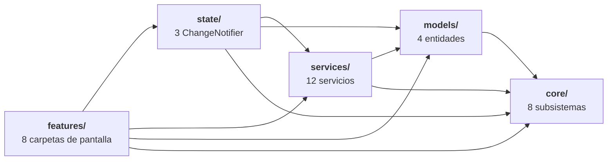
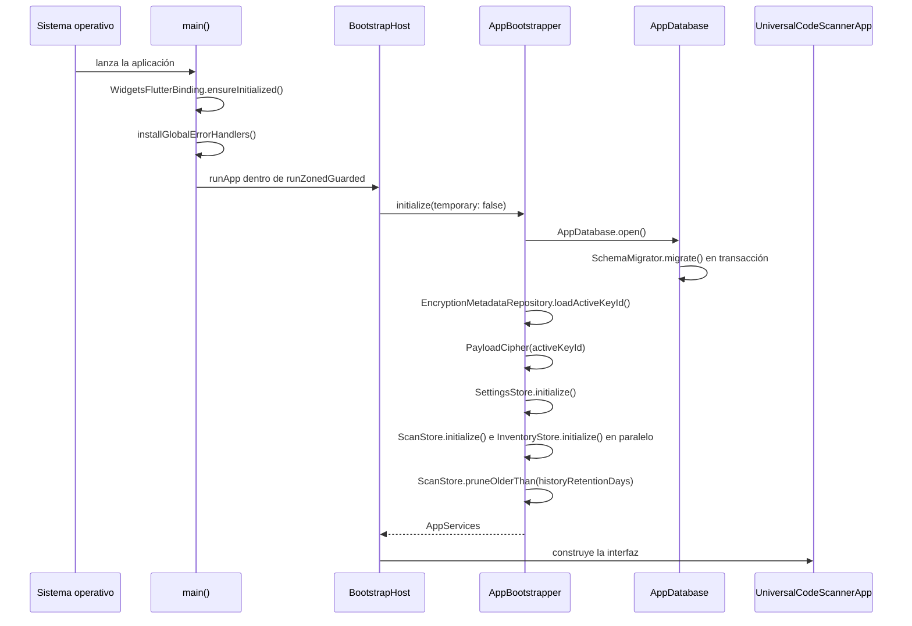
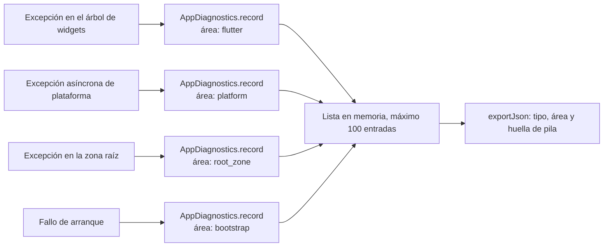
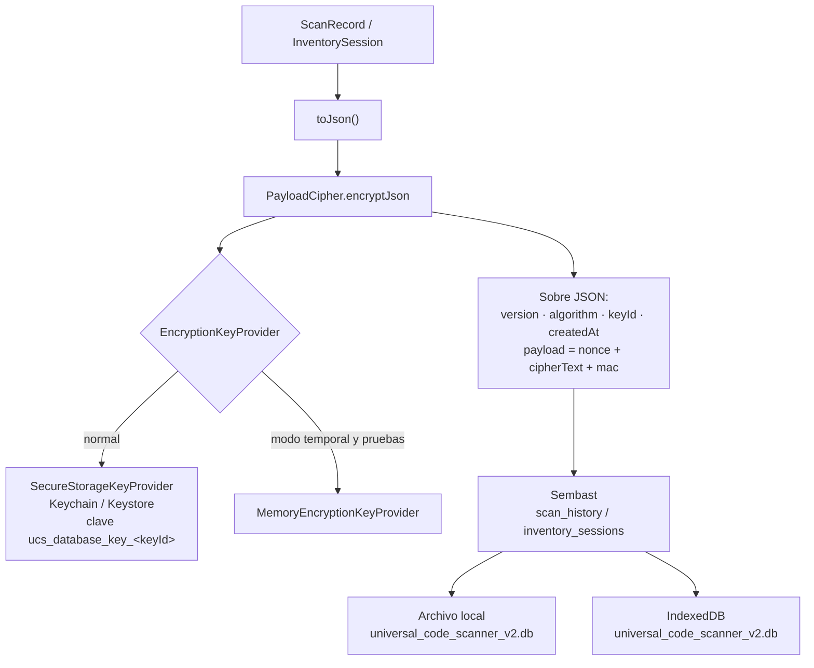
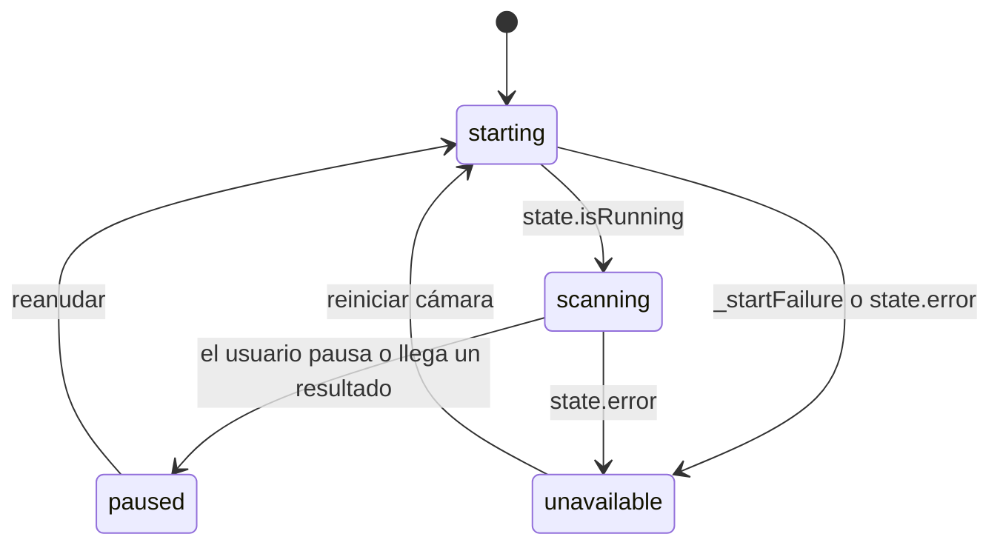

# 03 · Arquitectura

## La conclusión primero

Universal Code Scanner es una **aplicación de un solo proceso, sin red propia,
con estado en memoria y persistencia cifrada local**. Su arquitectura se apoya
en cinco capas de dependencia unidireccional y en tres fronteras de extensión
declaradas (`ScannerEngine`, `ContentParserRegistry`, `FeatureFlags`), de las
cuales **solo dos están realmente conectadas al flujo de ejecución**: la tercera,
`FeatureFlags`, se persiste y se restaura pero ningún código la consulta. Ver el
hallazgo R-02 de [15-risks-and-technical-debt.md](15-risks-and-technical-debt.md).

No hay inyección de dependencias por contenedor ni gestor de rutas: los
servicios se construyen una vez en `AppBootstrapper.initialize` y se pasan por
constructor hasta las pantallas. La navegación es un índice entero
(`_HomeShellState._index`) sobre una lista de cinco widgets.

## Las cinco capas

| Capa | Contenido |
|---|---|
| `features/` | `scanner` · `inventory` · `generator` · `history` · `settings` · `result` · `recovery` · `formats` |
| `state/` | `ScanStore` · `InventoryStore` · `SettingsStore` |
| `services/` | `ContentInterpreter` · `ImportService` · `ExportService` · `HistoryRepository` · `InventoryRepository` · `SettingsRepository` · `ScanFeedback` · `BiometricService` · `ClipboardService` · `PdfPageRenderer` |
| `models/` | `ScanRecord` · `InventorySession` · `ParsedContent` · `AppSettings` |
| `core/` | `database` · `security` · `recovery` · `performance` · `theme` · `localization` · `diagnostics` · `feature_flags` |

**Lo que muestra**: la dirección general de las dependencias. Ningún archivo de
`lib/core` ni de `lib/models` importa `lib/state`, y ningún archivo de
`lib/core` importa `lib/services` ni `lib/features` —comprobado con
`grep -rn "import 'package:universal_code_scanner/state" lib/core lib/models lib/services`,
que no devuelve nada.

**Lo que no muestra**: las dos excepciones reales, ambas verificadas por `grep`.

1. `lib/models/scan_record.dart` (línea 9) importa
   `lib/features/formats/domain/content_parser_registry.dart` —es decir, un
   modelo importa una carpeta de `features`. El registro de parsers está
   físicamente en `features/formats/domain/` pero conceptualmente pertenece a
   `services`. Es una inconsistencia de ubicación, no un ciclo:
   `content_parser_registry.dart` solo importa `ParsedContent` de `models`.
   Registrado como R-07.
2. `lib/core/recovery/recovery_service.dart` (líneas 8-9) importa
   `InventorySession` y `ScanRecord`, mientras que
   `lib/models/scan_record.dart` importa `core/security/scan_security_analyzer.dart`
   y `core/utils/barcode_labels.dart`. La arista entre `core` y `models` es por
   tanto **bidireccional a nivel de paquete**, aunque no haya ciclo entre
   archivos concretos. `RecoveryService` necesita los modelos para verificar que
   una carga descifrada es reconstruible antes de reinsertarla
   (`ScanRecord.fromJson(clear)` en `retry`), lo cual convierte un fallo de
   forma en un `false` en vez de en un registro corrupto reinsertado.

Tampoco muestra que `features/` contiene ocho subcarpetas, no cinco: además de
las cuatro pestañas hay `result/` (la hoja de resultados, compartida por escáner
e historial), `recovery/` (el Centro de recuperación, accesible desde Ajustes),
`formats/` (la pantalla de formatos compatibles y el registro de parsers) y
`settings/`.

## El arranque, paso a paso

Si cualquier paso lanza, `AppBootstrapper` cierra la base de datos que hubiera
abierto y relanza (`bootstrap.dart`, líneas 72-75). `_BootstrapHostState`
captura ese error, lo registra en `AppDiagnostics` bajo el área `bootstrap` y
construye `_StartupRecovery`, la pantalla de **inicio seguro**, con cuatro
salidas:

| Acción | Efecto |
|---|---|
| «Reintentar» | Repite `initialize(temporary: false)` |
| «Abrir sin historial ni inventarios persistentes» | `initialize(temporary: true)`: base Sembast **en memoria** y llave también en memoria |
| «Restablecer preferencias visuales» | `SettingsRepository.resetNonSensitive()` y reintento |
| «Copiar diagnóstico privado» | `AppDiagnostics.exportJson()` al portapapeles |

El texto bajo los botones enumera literalmente lo que el diagnóstico **no**
incluye: «códigos escaneados, enlaces, contraseñas, secretos OTP, notas ni
productos».

### Modo temporal: qué cambia exactamente

`AppBootstrapper.initialize(temporary: true)` altera tres cosas y solo tres:

1. `AppDatabase.openTemporary()` abre una base `databaseFactoryMemory` con
   nombre `ucs_temporary_<microsegundos>` en lugar del archivo real;
2. `PayloadCipher` recibe un `MemoryEncryptionKeyProvider` en vez del almacén
   seguro, y el `activeKeyId` es la constante `PayloadCipher.currentKeyId` sin
   consultar la base;
3. `SettingsStore.initialize()` se envuelve en `try/catch`: **el modo temporal
   sigue disponible aunque las preferencias no puedan leerse**.

La interfaz lo señala con un `MaterialBanner` permanente sobre el contenido
(`_HomeShellState.build`, línea 254) y con una entrada extra en Ajustes.
Además, la rotación de llave se deshabilita en modo temporal
(`SettingsScreen`, `enabled: !widget.temporaryMode && !_rotatingKey`).

## Gestión del estado

El patrón es `ChangeNotifier` + `AnimatedBuilder`/`addListener`. No hay Riverpod,
Bloc, Provider ni GetIt —**comprobado**: ninguno aparece en `pubspec.yaml`.

| Store | Notifica cuando | Lo consume |
|---|---|---|
| `SettingsStore` | Cambia cualquier preferencia | `UniversalCodeScannerApp` vía `AnimatedBuilder`; todas las pantallas leen `.value` directamente |
| `ScanStore` | Se carga, importa, actualiza, poda, elimina o limpia el historial | `HistoryScreen` (`addListener`), `SettingsScreen` (lectura directa) |
| `InventoryStore` | Cambia cualquier sesión o ítem | `InventoryScreen` (`addListener`) |

Consecuencia de diseño: **el tema y el idioma se recalculan en el nivel más alto
del árbol**, porque `AnimatedBuilder` sobre `settingsStore` envuelve al
`MaterialApp` completo. Cambiar «Alto contraste» reconstruye toda la aplicación.
Es correcto para un ajuste que afecta al `ThemeData`, y es la razón por la que
`SettingsScreen` no necesita escuchar el store: su propio `setState` no existe,
la reconstrucción llega desde arriba.

### Serialización de escrituras

`InventoryStore` protege **todas** sus mutaciones con una cola serial
(`AsyncWriteQueue`, `lib/core/performance/async_write_queue.dart`). Nueve
métodos pasan por `_writes.run<void>(...)`. La razón: el inventario recibe
lecturas continuas de la cámara mientras el usuario edita cantidades y notas, y
dos escrituras concurrentes sobre el mismo `InventorySession` inmutable se
pisarían.

`ScanStore` **no** usa la cola. Sus escrituras vienen de acciones puntuales del
usuario o de un lote ya cerrado, no de un flujo continuo. Es una asimetría
deliberada pero **no documentada en el repositorio**.

La cola tiene una propiedad que merece nombrarse: **un fallo no envenena la
cola**. `AsyncWriteQueue.run` captura la excepción dentro del `then` y la
entrega al `Completer` del llamante, de modo que la cadena `_tail` siempre
resuelve. Hay una prueba dedicada a ese comportamiento
(`test/core/async_write_queue_test.dart`, «a failed write does not block later
writes»).

## Manejo de errores

Hay cuatro niveles, y ninguno de ellos escribe nunca la carga escaneada.

`AppDiagnostics.record` guarda exactamente cuatro campos: instante UTC, área
saneada, **nombre del tipo** del error y una huella hexadecimal de 8 dígitos
calculada sobre `runtimeType` más las cuatro primeras líneas de la pila. El
mensaje del error **no se guarda**, y hay una prueba que lo verifica pasando un
`StateError` cuyo mensaje contiene `password=`, `otp=` y un dominio, y
comprobando que ninguno aparece en la exportación
(`test/core/diagnostics_test.dart`).

`_sanitize` reemplaza cualquier carácter fuera de `[a-zA-Z0-9_.-]` por `_` y
recorta a 80 caracteres. La lista se recorta a `maxEntries = 100` insertando
siempre al principio, de modo que se conservan los 100 errores **más recientes**.

Los diagnósticos **viven solo en memoria**: no hay ninguna escritura a disco. Se
pierden al cerrar la aplicación. *Inferencia*: es coherente con la política de
privacidad, pero significa que un fallo de arranque intermitente no deja rastro
entre sesiones.

## Persistencia y cifrado

Cada registro persistido guarda **tres campos en claro** —`id`, `scannedAt` (o
`createdAt`) y `payload`— y todo lo demás dentro del `payload` cifrado. Los dos
campos en claro existen porque Sembast necesita ordenar y filtrar sobre ellos:
`Finder(sortOrders: [SortOrder('scannedAt', false)])` en `HistoryRepository.load`
y `Filter.lessThan('scannedAt', cutoff)` en `pruneOlderThan`.

La consecuencia, que conviene tener presente en una auditoría: **el momento de
cada lectura es visible sin la llave**. El contenido no.

El detalle completo del esquema, los sobres y la rotación está en
[07-database.md](07-database.md).

## Fronteras de extensión

| Frontera | Archivo | Implementaciones en 1.1.0 | ¿Conectada? |
|---|---|---|---|
| `ScannerEngine` | `lib/features/scanner/domain/scanner_engine.dart` | Una: `MobileScannerEngine` | Sí, pero **solo en `ScannerScreen`** |
| `ContentParser` / `ContentParserRegistry` | `lib/features/formats/domain/` | Una: `LegacyContentParser`, prioridad `-1000` | Sí |
| `FeatureFlags` | `lib/core/feature_flags/feature_flags.dart` | Nueve banderas, todas `false` | **No** |

### `ScannerEngine`

Interfaz de ocho miembros que envuelve `MobileScannerController`. Su objetivo
declarado en `docs/ARCHITECTURE.md` es permitir un segundo motor —por ejemplo
sobre ZXing-C++ para Windows y Linux— sin tocar `ScanRecord`,
`ContentInterpreter` ni los repositorios.

**Hallazgo**: `InventoryScreen` no usa `ScannerEngine`. Construye su propio
`MobileScannerController` en `_createController()` y llama al controlador
directamente (`_controller.start()`, `_controller.toggleTorch`, …). Un segundo
motor requeriría también reescribir esa pantalla. Registrado como R-04.

### `ContentParserRegistry`

Singleton con una lista ordenada por prioridad descendente. `register` sustituye
por `id` y reordena; `unregister` elimina por `id` **salvo `builtin-v2`**, que no
puede quitarse (`content_parser_registry.dart`, línea 18).

`parse` recorre la lista y devuelve el primero cuyo `canParse` acepte. Como
`LegacyContentParser.canParse` devuelve siempre `true` y no puede desregistrarse,
**la línea de reserva final `return ContentInterpreter.parse(rawValue)` es
inalcanzable**. Es defensa redundante, no un error de comportamiento;
registrada como R-08.

### `FeatureFlags`

Nueve banderas: `experimentalParsers`, `secondaryScannerEngine`, `ocr`, `nfc`,
`urlReputation`, `productLookup`, `encryptedSync`, `enterpriseApi`, `kioskMode`.
Se serializan a la preferencia `feature_flags` y se restauran al arrancar.
**Comprobado con `grep` sobre las nueve**: ninguna se lee fuera de
`feature_flags.dart`. No hay condicional en `lib/` que dependa de una bandera, ni
control en Ajustes para cambiarlas. Son, en 1.1.0, una declaración de intención
persistida. R-02.

## Ciclo de vida de la cámara

Es la parte más delicada del código y la que originó la versión 1.1.0. El
resumen técnico:

`MobileScanner` **solo gestiona el ciclo de vida cuando él mismo crea el
controlador**. Estas dos pantallas le pasan el suyo, así que la gestión les
corresponde. Ambas implementan `WidgetsBindingObserver`:

| Estado del ciclo de vida | `ScannerScreen` | `InventoryScreen` |
|---|---|---|
| `resumed` | `_startCamera()` si no está en pausa ni mostrando resultado | `_startCamera()` si hay sesión activa y no está en pausa |
| `inactive` | `_stopCamera()` | `_stopCamera()` |
| `hidden`, `paused`, `detached` | Nada | Nada |

Y ambas ofrecen «Reiniciar cámara», que **libera el controlador antiguo antes de
crear el nuevo**. El orden importa y está comentado en el código
(`scanner_screen.dart`, líneas 120-122): ambos comparten una única sesión de
cámara de plataforma, y desechar el viejo *después* derribaría la sesión que el
nuevo acaba de reclamar.

El estado visible se reduce a cuatro fases (`ScanPhase`) derivadas del estado del
controlador y de dos banderas locales:

`ScanStatusBar` nombra cada fase, y su barra horizontal **solo se mueve mientras
el motor analiza cuadros de verdad** (`_ScanProgressBar`: `value: null` es la
barra indeterminada; un valor fijo la dibuja quieta). Con movimiento reducido
activado, la barra se dibuja llena y quieta y el marco no barre la línea. El
razonamiento de producto completo está en
[`../quality/SCANNER_UX.md`](../quality/SCANNER_UX.md).

## Concurrencia y trabajo fuera del hilo de interfaz

| Trabajo | Mecanismo | Archivo |
|---|---|---|
| Codificación CSV | `compute(_encodeCsv, rows)` | `export_service.dart` |
| Codificación XLSX | `compute(_encodeXlsx, request)` | `export_service.dart` |
| Escrituras de inventario | `AsyncWriteQueue` (serial, mismo isolate) | `inventory_store.dart` |
| Lotes de imágenes y PDF | Bucle con `await Future.delayed(Duration.zero)` entre elementos | `scanner_screen.dart` |
| Cifrado | Síncrono en el isolate principal, pero **precalculado antes de la transacción** | `history_repository.dart`, `data_maintenance_service.dart` |

El `Future.delayed(Duration.zero)` entre elementos de un lote cede el turno al
bucle de eventos, de modo que el diálogo de progreso pueda repintarse y el botón
«Cancelar» responda. No es paralelismo: **el análisis de 20 imágenes bloquea el
isolate principal por tramos**.

El cifrado se precalcula fuera de la transacción de forma deliberada
(`_migrateRecordsAtomically`, `upsertAll`, `replaceAll`, `rotateEncryptionKey`):
AES-GCM sobre miles de registros dentro de una transacción de Sembast
mantendría la base bloqueada mucho más tiempo del necesario.

## Cancelación

`CancellationToken` es un `ChangeNotifier` con una bandera y dos métodos. Se
propaga a dos niveles distintos en el caso del PDF:

1. el bucle del lote llama a `token.throwIfCancelled()` entre páginas;
2. el propio renderizador recibe un `PdfPageRenderCancellationToken` que se
   cancela mediante un *listener* registrado sobre el token de la aplicación
   (`pdf_page_renderer_io.dart`, líneas 48-53).

El *listener* se retira en un `finally` para no acumular suscripciones página a
página. Al cancelar, `PdfPageRenderer.cleanup` borra las imágenes ya escritas y
el directorio temporal, y el historial **no se modifica**: el mensaje al usuario
lo dice literalmente («Análisis cancelado sin modificar el historial»).

## Lo que está bien y conviene no romper

Un informe que solo enumera problemas da una imagen falsa. Estas propiedades del
diseño son sólidas y alguien las romperá si nadie dice que importan:

1. **Ninguna acción externa sin confirmación.** `launchUrl` aparece una sola vez
   en todo `lib/`, y está detrás de un diálogo.
2. **Una llave ausente nunca se regenera en silencio.** `PayloadCipher.decryptJson`
   registra el `keyId` en `_missingKeyIds` y a partir de ahí **también bloquea el
   cifrado** con ese identificador. Sin esa doble barrera, un descifrado fallido
   seguido de una escritura generaría una llave nueva y dejaría los datos
   antiguos ilegibles para siempre. Hay prueba dedicada.
3. **La rotación de llave limpia su propia basura.** Si falla, el `catch` llama a
   `forgetKey(keyId)` para que la llave recién creada no pueda confundirse
   después con una llave activa. Hay prueba dedicada.
4. **La migración del historial verifica antes de borrar.**
   `_migrateRecordsAtomically` comprueba `actual.containsAll(expected)` **dentro
   de la transacción** y lanza si falta algo; solo después se elimina la clave
   antigua.
5. **La importación se valida completa antes de tocar la base.** Tamaño,
   profundidad, número de nodos, procedencia y versión de esquema se comprueban
   sobre el JSON decodificado; la vista previa se muestra y la estrategia se
   elige antes de escribir.
6. **El diagnóstico es estructuralmente incapaz de filtrar datos.** No acepta
   una cadena de mensaje: acepta un `Object` y guarda su `runtimeType`.
7. **El error de audio no puede romper una lectura.** `ScanFeedback` degrada al
   sonido del sistema y marca `_toneUnavailable` para no volver a intentarlo.

---

Continúa en [04 · Mapa completo del código](04-code-map.md).
