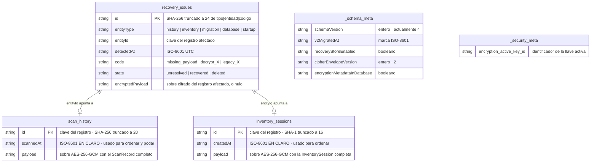

# 07 · Base de datos y persistencia

## Conclusión primero

Universal Code Scanner **no usa SQL**. Su persistencia son tres mecanismos
distintos, cada uno con una responsabilidad separada:

| Mecanismo | Qué guarda | Cifrado |
|---|---|---|
| **Sembast** (NoSQL local, documental) | Historial, sesiones de inventario, incidencias de recuperación, metadatos de esquema y de cifrado | **Sí**, el contenido; no las claves ni las marcas de tiempo de ordenación |
| **`flutter_secure_storage`** (Keychain / Keystore) | Las llaves AES-256 | Lo protege el sistema operativo |
| **`SharedPreferencesAsync`** | Preferencias de usuario y estado de migración | **No** |

No hay ORM, no hay migraciones SQL, no hay servidor de base de datos. El motivo
es coherente con el producto: una aplicación que no envía nada a ningún sitio no
necesita un esquema relacional que compartir, y Sembast es un archivo JSON
apend-only sin dependencias nativas.

## El motor: Sembast

| Aspecto | Valor | Archivo |
|---|---|---|
| Paquete nativo | `sembast 3.8.9+1` | `pubspec.yaml` |
| Paquete web | `sembast_web 2.4.5+1` (sobre IndexedDB) | idem |
| Nombre del archivo | `universal_code_scanner_v2.db` | `database_opener_io.dart`, `database_opener_web.dart` |
| Ubicación nativa | `getApplicationSupportDirectory()` | `database_opener_io.dart` |
| Ubicación web | IndexedDB del origen | `database_opener_web.dart` |
| `version` de Sembast | `2` | Ambos abridores |
| Plataforma no soportada | Lanza `UnsupportedError` | `database_opener_stub.dart` |

La selección de implementación es una exportación condicional:

```dart
export 'database_opener_stub.dart'
    if (dart.library.io) 'database_opener_io.dart'
    if (dart.library.js_interop) 'database_opener_web.dart';
```

**Las dos versiones que no hay que confundir.** Sembast recibe `version: 2` al
abrir el archivo, y ese número no se ha tocado desde que el archivo pasó a
llamarse `…_v2.db`. `SchemaMigrator` mantiene **su propio** contador en el
almacén `_schema_meta`, actualmente en `4`. Son independientes: el primero es la
versión de formato de Sembast; el segundo, la del esquema lógico de la
aplicación.

### La base temporal

`AppDatabase.openTemporary()` abre `databaseFactoryMemory` con nombre
`ucs_temporary_<microsegundos>`. Nunca toca disco, se pierde al cerrar y el
nombre único evita que dos aperturas en la misma sesión compartan estado. Es lo
que respalda el «modo temporal» de la pantalla de inicio seguro, y también lo que
usan todas las pruebas que necesitan una base.

## Diagrama de almacenes



**Lo que muestra**: los cinco almacenes y qué campos van en claro.

**Lo que no muestra**: que Sembast no impone ninguna integridad referencial. La
relación entre `recovery_issues.entityId` y las claves de los otros dos almacenes
es **una convención del código**, no una restricción del motor. Si el usuario
borra un registro del historial, la incidencia asociada sigue existiendo y
apuntando a una clave inexistente; su acción «Descartar» simplemente no
encontrará nada que borrar y marcará la incidencia como `deleted`.

Tampoco muestra que el contenido de `payload` es opaco: los campos reales del
`ScanRecord` viven dentro y no son consultables por Sembast.

## Diccionario de datos

### Almacén `scan_history`

`stringMapStoreFactory.store('scan_history')`. Escrito por `HistoryRepository`,
`RecoveryService.retry` y `DataMaintenanceService.rotateEncryptionKey`.

| Campo | Tipo | En claro | Origen | Uso |
|---|---|---|---|---|
| `id` | `String` | Sí | `ScanRecord.id` | Clave del registro; también duplicado como campo |
| `scannedAt` | `String` ISO-8601 | **Sí** | `ScanRecord.scannedAt` | `SortOrder` en `load`, `Filter.lessThan` en `pruneOlderThan`, `SortOrder` ascendente en `_trim` |
| `payload` | `String` (JSON del sobre) | No | `PayloadCipher.encryptJson(record.toJson())` | Todo el contenido |

Dentro del `payload`, una vez descifrado, está el `ScanRecord` completo:

| Campo | Tipo | Nulo | Significado |
|---|---|---|---|
| `id` | `String` | no | SHA-256 de `rawValue\|microsegundos`, 20 caracteres |
| `rawValue` | `String` | no | Texto exacto del código, o `binary-base64:<base64>` |
| `displayValue` | `String` | no | Lo que se muestra; para binario antepone `Datos binarios (N bytes)` |
| `format` | `String` | no | Etiqueta legible de la simbología (`BarcodeLabels.format`) |
| `contentType` | `String` | no | `ParsedContent.title` |
| `scannedAt` | `String` ISO-8601 | no | Momento de la lectura, hora local |
| `source` | `String` | no | `Cámara`, `Imagen`, `PDF · página N`, `Inventario`, `Importado` |
| `riskLevel` | `String` | no | `low`, `caution` o `high` |
| `riskReasons` | `List<String>` | no | Motivos en español; puede estar vacía |
| `canOpen` | `bool` | no | Si existe una acción externa posible |
| `parsed` | `Map` | no | `ParsedContent` serializado |
| `favorite` | `bool` | no | Marca del usuario |
| `tags` | `List<String>` | no | Etiquetas del usuario, deduplicadas |
| `notes` | `String` | no | Nota libre del usuario |

Y dentro de `parsed`:

| Campo | Tipo | Significado |
|---|---|---|
| `kind` | `String` | Uno de los 17 valores de `ContentKind` |
| `title` | `String` | Nombre legible del tipo, en español |
| `summary` | `String?` | Resumen de una línea: dominio, nombre del contacto, GTIN… |
| `fields` | `Map<String,String>` | Campos interpretados, con nombre en español |
| `sensitive` | `bool` | Decide si se persiste automáticamente y si se enmascara |

**Nota sobre las fechas.** `scannedAt` se guarda con `toIso8601String()` sobre un
`DateTime` **local** (`DateTime.now()`), sin sufijo de zona. Comparar registros
creados en zonas horarias distintas produciría un orden incorrecto. Los
`detectedAt` de recuperación y los `createdAt`/`exportedAt` de los sobres sí usan
`toUtc()`. Es una inconsistencia real. R-22.

### Almacén `inventory_sessions`

`stringMapStoreFactory.store('inventory_sessions')`. Escrito por
`InventoryRepository`, `RecoveryService.retry` y la rotación.

| Campo | Tipo | En claro | Uso |
|---|---|---|---|
| `id` | `String` | Sí | SHA-1 de `microsegundos\|nombre`, 16 caracteres |
| `createdAt` | `String` ISO-8601 | **Sí** | `SortOrder('createdAt', false)` en `load` |
| `payload` | `String` | No | Sobre cifrado con la sesión completa |

Dentro del `payload`, `InventorySession`:

| Campo | Tipo | Nulo | Significado |
|---|---|---|---|
| `id` | `String` | no | El mismo de la clave |
| `name` | `String` | no | Nombre dado por el usuario, o `Inventario DD-MM-AAAA` |
| `createdAt` | `String` | no | Creación |
| `closedAt` | `String?` | **sí** | `null` mientras la sesión está abierta |
| `items` | `Map<String, InventoryItem>` | no | **Indexado por el texto bruto del código** |

Y cada `InventoryItem`:

| Campo | Tipo | Significado | Inmutable tras crear |
|---|---|---|---|
| `code` | `String` | Texto bruto del código; igual a la clave | Sí |
| `format` | `String` | Simbología | Sí |
| `label` | `String` | `parsed.summary` o `contentType` | Sí |
| `quantity` | `int` | Unidades contadas | No |
| `firstScannedAt` | `String` | Primera lectura | Sí |
| `lastScannedAt` | `String` | Última lectura o edición | No |
| `notes` | `String` | Nota del usuario | No |

`InventoryItem.fromJson` es tolerante: `format`, `label`, `quantity` y `notes`
tienen valores por defecto (`'Desconocido'`, `'Producto'`, `1`, `''`). `code`,
`firstScannedAt` y `lastScannedAt` **no**: su ausencia lanza. Es lo que hace que
un JSON importado sin esos campos se rechace.

### Almacén `recovery_issues`

`stringMapStoreFactory.store('recovery_issues')`. Escrito solo por
`RecoveryRepository`.

| Campo | Tipo | Significado |
|---|---|---|
| `id` | `String` | SHA-256 de `entityType\|entityId\|code`, 24 caracteres. **Determinista**: la misma incidencia no se duplica |
| `entityType` | `String` | Uno de los 5 valores; solo 3 se emiten |
| `entityId` | `String` | Clave del registro afectado, o `history_v1_to_v2` para la migración |
| `detectedAt` | `String` ISO-8601 **UTC** | Momento de la detección |
| `code` | `String` | `missing_payload`, `decrypt_<Tipo>`, `legacy_<Tipo>` |
| `state` | `String` | `unresolved`, `recovered`, `deleted` |
| `encryptedPayload` | `String?` | El sobre del registro afectado, **todavía cifrado** |

Todo este almacén se guarda **sin cifrar**, pero no contiene datos del usuario:
solo identificadores técnicos y, cuando existe, un sobre que ya está cifrado.

### Almacén `_schema_meta`

`StoreRef<String, Object?>('_schema_meta')`. Escrito solo por `SchemaMigrator`.

| Clave | Tipo | Escrita en | Valor |
|---|---|---|---|
| `schemaVersion` | `int` | Siempre | Versión final tras migrar; actualmente `4` |
| `v2MigratedAt` | `String` | Migración a 2 | Marca ISO-8601 UTC |
| `recoveryStoreEnabled` | `bool` | Migración a 3 | `true` |
| `cipherEnvelopeVersion` | `int` | Migración a 3 | `2` |
| `encryptionMetadataInDatabase` | `bool` | Migración a 4 | `true` |

**Las cuatro marcas descriptivas no las lee nadie.** Comprobado con `grep`:
`v2MigratedAt`, `recoveryStoreEnabled`, `cipherEnvelopeVersion` y
`encryptionMetadataInDatabase` solo aparecen en `schema_migrator.dart`. Son
registro histórico, no configuración. R-23.

### Almacén `_security_meta`

`StoreRef<String, Object?>('_security_meta')`. Escrito por
`EncryptionMetadataRepository` y por la rotación.

| Clave | Tipo | Significado |
|---|---|---|
| `encryption_active_key_id` | `String` | Identificador de la llave con la que se cifra ahora: `v2` o `v3_<epoch_ms>` |

## Migraciones de esquema

`SchemaMigrator.migrate()` es idempotente y transaccional:

```dart
final int initial = await _meta.record('schemaVersion').get(database) as int? ?? 1;
int version = initial;
final List<int> applied = <int>[];
await database.transaction((transaction) async {
  if (version < 2) { … version = 2; applied.add(2); }
  if (version < 3) { … version = 3; applied.add(3); }
  if (version < 4) { … version = 4; applied.add(4); }
  await _meta.record('schemaVersion').put(transaction, version);
});
```

| Paso | Desde | Hasta | Qué hace |
|---|---|---|---|
| 1 | 1 (o base nueva) | 2 | Escribe `v2MigratedAt` |
| 2 | 2 | 3 | Reserva la recuperación (`recoveryStoreEnabled`) y declara el sobre v2 (`cipherEnvelopeVersion`) |
| 3 | 3 | 4 | Declara que los metadatos de cifrado viven en la base (`encryptionMetadataInDatabase`) |

Ninguno de los tres pasos crea almacenes ni transforma datos: **Sembast crea los
almacenes de forma perezosa** al primer uso, y el comentario del código lo dice
explícitamente. Las migraciones son, por tanto, marcas de estado.

Una base nueva parte de `1` (el `?? 1` del principio) y aplica los tres pasos en
una sola transacción. Una segunda llamada no aplica ninguno: la prueba
`test/core/schema_migrator_test.dart` verifica exactamente eso —`first.applied`
no vacía y `second.applied` vacía— y que `toVersion` es `currentVersion` en
ambos casos.

`SchemaMigrationResult` devuelve `fromVersion`, `toVersion` y `applied`, pero
**el resultado se descarta**: `AppDatabase.open()` hace `await
SchemaMigrator(...).migrate();` sin usarlo. Solo la prueba lo consume. R-24.

## El sobre de cifrado

Cada `payload` es un JSON con esta forma:

```json
{
  "version": 2,
  "algorithm": "AES-256-GCM",
  "keyId": "v2",
  "createdAt": "2026-08-27T12:00:00.000Z",
  "payload": {
    "nonce": "<base64>",
    "cipherText": "<base64>",
    "mac": "<base64>"
  }
}
```

Los cuatro campos de cabecera van **en claro** a propósito: sin ellos no habría
forma de decidir con qué llave y con qué algoritmo intentar el descifrado. No
revelan nada del contenido.

`createdAt` **no se lee en ninguna decisión del código** —comprobado con `grep`—
y existe como dato forense.

### El sobre heredado

El formato inicial no escribía cabecera: el `payload` era directamente el objeto
`{nonce, cipherText, mac}`. La detección es la **ausencia** del campo `version`:

```dart
final bool legacy = !envelope.containsKey('version');
```

Un sobre heredado se descifra con `legacyKeyId`, que vale `'v2'` —el mismo valor
que `currentKeyId`. Ver la nota R-13 en
[05-technical-reference.md](05-technical-reference.md).

### Reglas de compatibilidad

| Caso | Comportamiento |
|---|---|
| `version` entre 1 y `currentVersion` | Se acepta |
| `version` mayor que `currentVersion` | `FormatException('Versión de cifrado no compatible: N')` |
| `algorithm` distinto de `AES-256-GCM` | `FormatException('Algoritmo no compatible: X')` |
| Llave del `keyId` ausente | `StateError('encryption_key_missing:<keyId>')` y bloqueo de escritura con ese identificador |
| MAC que no valida | Excepción de `cryptography`; el registro se aísla como incidencia |

Las tres primeras tienen prueba dedicada en `test/core/payload_cipher_test.dart`.

### Actualización perezosa

Tras cada descifrado correcto, ambos repositorios comprueban con `inspect` —que
no descifra— si el sobre es heredado o de versión anterior, y en ese caso lo
reescriben. **Leer el historial escribe en la base.** La condición **no compara
el `keyId`**, así que un registro cifrado con una llave anterior pero versión
actual no se actualiza al leerlo: eso lo hace la rotación.

## Rotación de llave

Detallada en [06-deep-code-explanation.md](06-deep-code-explanation.md), apartado
6. Resumen del contrato de datos:

1. La nueva llave se llama `v3_<epoch_ms>`.
2. Todos los sobres de **ambos** almacenes se recifran.
3. Registros y metadato `encryption_active_key_id` se escriben en **una sola
   transacción**.
4. Un registro sin `payload` aborta la operación completa.
5. Si falla, la llave nueva se borra del almacén seguro.
6. Las llaves **anteriores no se borran**: quedan en el almacén seguro bajo
   `ucs_database_key_<keyId>`.

## Llaves en el almacén seguro

| Aspecto | Valor |
|---|---|
| Prefijo de clave | `ucs_database_key_` |
| Clave completa | `ucs_database_key_v2`, `ucs_database_key_v3_<epoch_ms>` |
| Formato del valor | La llave AES de 256 bits en Base64 |
| Caché en memoria | `SecureStorageKeyProvider._cache`, por `keyId` |
| Backend | Keychain en Apple, Keystore/EncryptedSharedPreferences en Android, según `flutter_secure_storage 10.3.1` |

En Android, `allowBackup="false"` (aplicado por `tool/bootstrap.py`) impide que
el sistema restaure una copia de seguridad sin el material criptográfico
compatible. En la web, `flutter_secure_storage` **no ofrece un almacén protegido
por el sistema**: su implementación web depende del origen del navegador, tal
como advierte `docs/SECURITY.md`. **Requiere validación** el comportamiento
concreto en la PWA publicada.

## Preferencias

`SharedPreferencesAsync` guarda 22 claves en total: 17 de configuración, 4 de
estado de migración del historial y 1 heredada de metadatos de cifrado. El
catálogo completo está en
[05-technical-reference.md](05-technical-reference.md) y la semántica de cada
una en [10-configuration.md](10-configuration.md).

**Nada de lo guardado en preferencias está cifrado.** Contiene decisiones del
usuario, no datos escaneados —con una excepción histórica: `scan_history_v1`, el
historial en claro de una versión anterior, que la migración convierte y elimina.
Su respaldo (`scan_history_v1_backup`) **sí va cifrado**.

## Qué se pierde y cuándo

| Acción | Historial | Inventarios | Preferencias | Llaves |
|---|---|---|---|---|
| Cerrar la aplicación | Se conserva | Se conserva | Se conservan | Se conservan |
| Cerrar en **modo temporal** | **Se pierde** | **Se pierde** | Se conservan | La de memoria se pierde |
| «Borrar todo el historial» | **Se pierde** | Se conserva | Se conservan | Se conservan |
| Rotar la llave | Se conserva, recifrado | Se conserva, recifrado | Se conservan | Se añade una nueva |
| Retención de 30/90/365 días | Se poda lo antiguo | Se conserva | Se conservan | Se conservan |
| Superar 5000 registros | Se recorta lo más antiguo | Se conserva | Se conservan | Se conservan |
| Borrar los datos de la aplicación | **Se pierde** | **Se pierde** | **Se pierden** | Dependen del sistema |
| **Desinstalar** | **Se pierde para siempre** | **Se pierde para siempre** | **Se pierden** | **Se pierden** |

La última fila es la que conviene decir en voz alta: **no hay copia remota
porque no hay servidor**. Exportar antes de desinstalar es la única forma de
conservar el historial.

## Relación entre almacenes y módulos

| Almacén | Lo lee | Lo escribe |
|---|---|---|
| `scan_history` | `HistoryRepository.load`, `.ids`, `.pruneOlderThan`, `._trim`, `DataMaintenanceService` | `HistoryRepository` (5 métodos), `RecoveryService.retry`, `RecoveryService.discard`, `DataMaintenanceService` |
| `inventory_sessions` | `InventoryRepository.load`, `DataMaintenanceService` | `InventoryRepository.save`, `.remove`, `RecoveryService.retry`, `.discard`, `DataMaintenanceService` |
| `recovery_issues` | `RecoveryRepository.load`, `.mark`, `.clearResolved` | `RecoveryRepository.record`, `.mark`, `.clearResolved` |
| `_schema_meta` | `SchemaMigrator.migrate` | `SchemaMigrator.migrate` |
| `_security_meta` | `EncryptionMetadataRepository.loadActiveKeyId` | `.saveActiveKeyId`, `DataMaintenanceService` |

## Documentación previa relacionada

- [`../quality/MIGRATIONS.md`](../quality/MIGRATIONS.md): esquema, sobres y
  rotación desde la perspectiva de la política.
- [`../quality/RECOVERY.md`](../quality/RECOVERY.md): el Centro de recuperación.
- [`../quality/COMPATIBILITY_CONTRACT.md`](../quality/COMPATIBILITY_CONTRACT.md):
  los ocho compromisos sobre los datos del usuario que no pueden romperse.

---

Continúa en [08 · Flujo de datos](08-data-flow.md).
