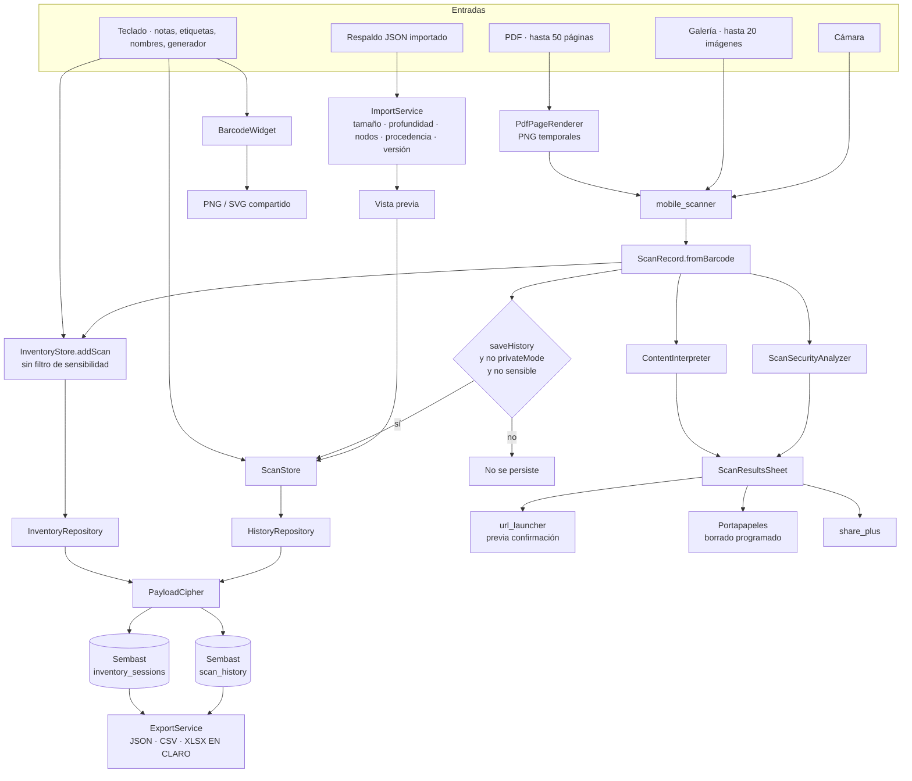
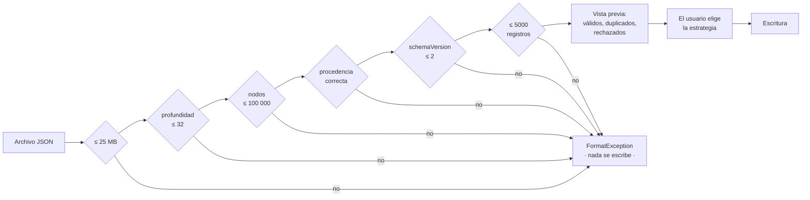
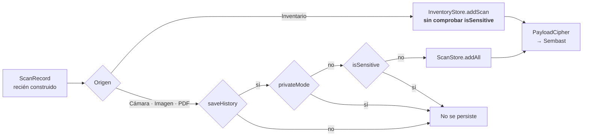

# 08 · Flujo de datos

Este documento sigue **cada dato** desde su origen hasta su destino: quién lo
crea, qué validación atraviesa, cómo se transforma, dónde se guarda y por dónde
puede salir del dispositivo.

## Panorama



**Lo que muestra**: las cinco entradas, el punto único de convergencia
(`ScanRecord.fromBarcode`), la bifurcación entre persistencia y presentación, y
las cinco salidas del dispositivo.

**Lo que no muestra**: que ninguna de las cinco salidas ocurre sin una acción
explícita del usuario, y que la única que atraviesa un diálogo obligatorio es
`url_launcher`. Tampoco muestra el flujo de recuperación ni el de rotación de
llave, que operan sobre datos ya persistidos.

## Entrada 1 · Cámara

| Etapa | Qué ocurre | Validación |
|---|---|---|
| Captura | `MobileScanner.onDetect` entrega un `BarcodeCapture` | El motor ya validó la simbología |
| Filtro | `_handleCapture` descarta si está en pausa, ya procesando o desmontado | — |
| Extracción | `ScanRecord.payloadForBarcode` obtiene texto o `binary-base64:` | Se descartan los códigos con carga vacía |
| Deduplicación intra-captura | `unique.putIfAbsent(raw, …)` | Por texto exacto |
| Deduplicación entre capturas | Firma ordenada + ventana de 2 s | — |
| Construcción | `ScanRecord.fromBarcode` | Analizador e intérprete |
| Persistencia | Condicionada por tres banderas | Ver más abajo |
| Presentación | `ScanResultsSheet` con **todos** los registros | — |

El `source` es siempre `'Cámara'`.

## Entrada 2 · Galería

| Etapa | Qué ocurre |
|---|---|
| Selección | `ImagePicker.pickMultiImage(limit: 20)` |
| Preparación | Se detiene la cámara y se abre el diálogo de progreso |
| Por imagen | `token.throwIfCancelled()` → `_engine.analyzeImage(path)` → deduplicar por texto → `ScanRecord.fromBarcode(source: 'Imagen')` |
| Cesión | `await Future<void>.delayed(Duration.zero)` entre imágenes |
| Final | Reanudar la cámara; persistir y mostrar, o avisar de que no se encontró nada |

Cada imagen tiene su propio `DateTime.now()`, así que registros de la misma
tanda pueden diferir en milisegundos.

**Qué no pasa**: las imágenes originales **no se copian ni se guardan**. Se leen
por ruta desde donde el selector las entregó.

## Entrada 3 · PDF

| Etapa | Qué ocurre | Límite |
|---|---|---|
| Selección | `FilePicker.pickFiles(type: custom, allowedExtensions: ['pdf'], withData: false)` | Un solo archivo |
| Apertura | `PdfDocument.openFile(path)` | — |
| Directorio | `getTemporaryDirectory()` + `ucs_pdf_<microsegundos>` | — |
| Por página | `page.render(...)` a PNG con escala `_renderScale` | 50 páginas, 2400 px en el lado mayor |
| Escritura | `File(outputPath).writeAsBytes(..., flush: true)` | `page_N.png` |
| Análisis | `_engine.analyzeImage(page.imagePath)` | — |
| Limpieza | `PdfPageRenderer.cleanup(pages)` borra PNG y directorio | En éxito, error y cancelación |

El `source` es `'PDF · página N'`, con el número real de página.

**`withData: false` es importante**: el selector devuelve la ruta, no los bytes.
Un PDF de 200 MB no se carga en memoria; se abre en disco.

**Los PNG temporales son datos en claro en disco**, durante el tiempo que dura
el análisis. Es inevitable —el motor de lectura recibe una ruta— y la limpieza
cubre los tres caminos de salida. Está registrado como riesgo aceptado en
[11-security.md](11-security.md).

**No disponible en web**: `_scanFromPdf` sale de inmediato si `kIsWeb`, y el
menú de importación está deshabilitado (`enabled: !kIsWeb`).

## Entrada 4 · Respaldo JSON

Es la entrada con más validación, porque es la única que viene de un archivo que
el usuario no creó necesariamente.



**Lo que muestra**: que hay seis puertas antes de que un byte llegue a la base, y
que la escritura solo ocurre después de una elección explícita.

**Lo que no muestra**: dos cosas. La primera, que un registro individual mal
formado **no aborta la importación**: se cuenta en `rejected` y se sigue; solo
los fallos de forma del archivo completo lanzan. La segunda, que si la raíz del
JSON es una **lista** en vez de un objeto se acepta como formato heredado
(`schemaVersion: 1`) **sin comprobar procedencia ni versión**, saltándose las
puertas cuarta y quinta.

`_validateJsonShape` usa una pila explícita en lugar de recursión, precisamente
para que un JSON profundo no provoque un desbordamiento de pila antes de llegar
a la comprobación de profundidad. El límite de profundidad se evalúa por rama; el
de nodos, sobre el total.

El inventario sigue el mismo camino con dos diferencias: acepta un objeto
heredado sin campo `application`, y comprueba `maxInventoryItems = 10000`. Se
importa **siempre como copia**: `InventoryStore.importSession` genera un `id`
nuevo y añade `(importado)` al nombre.

## Entrada 5 · Teclado

| Dato | Dónde se escribe | Validación | Destino |
|---|---|---|---|
| Notas de un registro | `HistoryScreen._edit` | `trim()` | `ScanRecord.notes`, cifrado |
| Etiquetas | idem | Separadas por comas, `trim()`, vacías descartadas, `toSet()` | `ScanRecord.tags`, cifrado |
| Nombre de sesión | `InventoryScreen` | Si queda vacío tras `trim()`, se usa `Inventario DD-MM-AAAA` | `InventorySession.name`, cifrado |
| Nota de producto | `InventoryScreen._editItemNotes` | `trim()` | `InventoryItem.notes`, cifrado |
| Cantidad | Botones ± y `setQuantity` | `≤ 0` elimina el ítem | `InventoryItem.quantity`, cifrado |
| Campos del generador | `GeneratorScreen` | Ninguna previa; `BarcodeWidget.errorBuilder` avisa si el formato no admite el contenido | **No se persiste** |

**Lo que el usuario escribe en el generador no se guarda en ningún sitio.** Vive
en cuatro `TextEditingController` que se liberan al salir de la pestaña.

## Transformación central: `ScanRecord.fromBarcode`

Es el único punto donde convergen todas las lecturas.

| Paso | Entrada | Salida |
|---|---|---|
| 1 | `Barcode` | `raw` = texto, o `binary-base64:<b64>`, o cadena vacía |
| 2 | `raw` | `SecurityAssessment(level, reasons, canOpen, normalizedHost)` |
| 3 | `raw` | `ParsedContent(kind, title, fields, summary, sensitive)` |
| 4 | `raw` + marca de tiempo | `id` = SHA-256 truncado a 20 |
| 5 | Todo lo anterior | `ScanRecord` inmutable |

`normalizedHost` del `SecurityAssessment` **se descarta**: `ScanRecord` no lo
guarda. Solo se usa el `level`, los `reasons` y el `canOpen`. R-25.

## Decisión de persistencia



**Lo que muestra**: la asimetría real entre el escáner y el inventario. El
escáner aplica tres condiciones; el inventario, ninguna.

**Lo que no muestra**: que en ambos casos el dato acaba **cifrado con la misma
llave**. La diferencia no es de protección criptográfica, sino de que un secreto
que el usuario esperaba que no se guardara, en el inventario sí se guarda.
Registrado como R-03.

`isSensitive` es `true` para: OTP, criptomonedas, EMVCo, EPC/SEPA, Swiss QR,
AAMVA y Wi-Fi **solo si trae contraseña**.

## Salidas del dispositivo

| Salida | Mecanismo | Confirmación previa | Qué sale |
|---|---|---|---|
| Abrir un enlace o acción | `url_launcher` | **Obligatoria** si `confirmBeforeOpen` o riesgo ≠ `low` | La URI |
| Compartir el contenido leído | `share_plus` | Obligatoria **solo si el registro es sensible** | El `rawValue`, o un `.vcf`/`.ics` |
| Copiar al portapapeles | `Clipboard.setData` | Ninguna | El `rawValue`, con borrado programado |
| Exportar historial o inventario | `share_plus` | Ninguna | JSON, CSV o XLSX **en claro** |
| Compartir un código generado | `share_plus` | Ninguna | PNG o SVG |
| Copiar el diagnóstico | `Clipboard.setData` | Ninguna | Solo tipos de error y huellas |
| Copiar el paquete de recuperación | `Clipboard.setData` | Ninguna | Sobres **todavía cifrados**, sin llaves |

### Apertura de un enlace

```dart
final bool shouldConfirm = widget.settings.value.confirmBeforeOpen || record.riskLevel != RiskLevel.low;
```

Es una **disyunción**: aunque el usuario desactive «Confirmar antes de abrir»,
un riesgo `caution` o `high` sigue exigiendo el diálogo. El texto del diálogo
cambia según el nivel.

`_actionUri` decide qué se puede abrir:

```dart
if (record.canOpen) return ScanSecurityAnalyzer.normalizedActionUri(record.rawValue);
return switch (record.parsed.kind) {
  ContentKind.phone || ContentKind.email || ContentKind.sms || ContentKind.geo => Uri.tryParse(record.rawValue),
  _ => null,
};
```

La rama de reserva cubre el caso en que el analizador dijera `canOpen: false`
pero el intérprete identificó un tipo con acción natural. En la práctica esos
cuatro tipos ya obtienen `canOpen: true` del analizador —son esquemas de sistema
seguros— así que la rama es redundante en 1.1.0.

### Portapapeles

```dart
await Clipboard.setData(ClipboardData(text: value));
if (clearAfterSeconds <= 0) return;
Timer(Duration(seconds: clearAfterSeconds), () async {
  final ClipboardData? current = await Clipboard.getData(Clipboard.kTextPlain);
  if (current?.text == value) await Clipboard.setData(const ClipboardData(text: ''));
});
```

Tres propiedades:

1. **`0` significa nunca borrar**, y es una opción del desplegable.
2. **El borrado comprueba antes** que el portapapeles siga conteniendo el mismo
   valor: si el usuario copió otra cosa entre medias, no se le borra.
3. **El temporizador no se guarda ni se cancela.** Sobrevive al `dispose` del
   widget que lo creó y se dispara aunque el usuario haya salido de la pantalla.
   Es intencional —el objetivo es limpiar el portapapeles pase lo que pase— pero
   significa que no hay forma de cancelarlo. R-26.

### Compartir

`ScanRecordCard._shareRecord` tiene tres caminos:

| Condición | Qué se comparte |
|---|---|
| `record.isSensitive` | Diálogo de advertencia primero; si se cancela, no se comparte |
| `kind == contact` | Archivo `contacto.vcf` con MIME `text/vcard` |
| `kind == event` | Archivo `evento.ics` con MIME `text/calendar` |
| Resto | Texto plano (`ShareParams(text: record.rawValue)`) |

El contacto y el evento se comparten como **archivo con el `rawValue` íntegro**,
de modo que la aplicación de destino lo reconozca y ofrezca guardarlo.

### Exportación

Todo lo exportado sale **en claro**. La entrada del menú no advierte de ello;
la advertencia vive en `docs/SECURITY.md` («La exportación JSON, CSV y XLSX
contiene datos descifrados por decisión explícita del usuario»). R-27.

El JSON lleva sobre de procedencia (`application`, `schemaVersion: 2`,
`exportedAt`, `type`), que es lo que después valida `ImportService`. CSV y XLSX
no llevan sobre: **no se pueden reimportar**.

## Datos que nunca salen del dispositivo

| Dato | Por qué |
|---|---|
| Las llaves AES | Solo `flutter_secure_storage`; el paquete de recuperación lo verifica con prueba |
| El texto de los mensajes de error | `AppDiagnostics` guarda `runtimeType`, no el mensaje |
| Las contraseñas Wi-Fi y los secretos OTP leídos desde el escáner | No se persisten; se muestran enmascarados si el ajuste está activo |
| Lo que se escribe en el generador | No se persiste en ningún sitio |
| El historial y los inventarios | No existe canal de red saliente propio |

**Comprobación de la última fila**:

```bash
grep -rn "HttpClient\|package:http\|WebSocket\|dart:html" lib --include=*.dart
```

no devuelve nada, y `pubspec.yaml` no declara ningún cliente HTTP. El único
paquete que entrega datos fuera es `url_launcher`, que delega en el sistema
operativo una URI que el usuario ya confirmó, y `share_plus`, que abre el
selector del sistema.

## Ciclo de vida de un dato concreto: una URL escaneada

Para hacerlo tangible, el recorrido completo de `https://example.com/pago?id=42`:

| # | Dónde | Qué le pasa |
|---|---|---|
| 1 | `MobileScanner` | El motor devuelve un `Barcode` con `rawValue` |
| 2 | `payloadForBarcode` | Devuelve el texto tal cual |
| 3 | `ScanSecurityAnalyzer.analyze` | HTTPS, host normal, sin señales → `low`, `canOpen: true` |
| 4 | `ContentInterpreter.parse` | `ContentKind.url`, `summary: example.com`, campos `Dominio`, `Protocolo`, `Ruta`, `Consulta`, `Dirección` |
| 5 | `ScanRecord.fromBarcode` | `id` = SHA-256 de `URL\|microsegundos`, 20 caracteres |
| 6 | `_persistAndShow` | No es sensible → entra en `ScanStore.addAll` |
| 7 | `HistoryRepository.upsert` | `encryptJson(record.toJson())` |
| 8 | Sembast | `{id, scannedAt: "2026-08-27T…", payload: "{version:2,…}"}` |
| 9 | `ScanResultsSheet` | Cinco campos con nombre, banda verde «Sin señales evidentes» |
| 10 | El usuario pulsa «Abrir» | Diálogo si `confirmBeforeOpen`; después `launchUrl` |
| 11 | Más tarde, en Historial | `load` descifra, `inspect` confirma que el sobre está al día, se muestra |
| 12 | A los 90 días con retención activa | `pruneOlderThan` lo borra por `scannedAt` |

En ningún punto de esas doce etapas la URL sale del dispositivo, salvo en la
etapa 10 y solo con confirmación.

---

Continúa en [09 · APIs e integraciones](09-apis-and-integrations.md).
