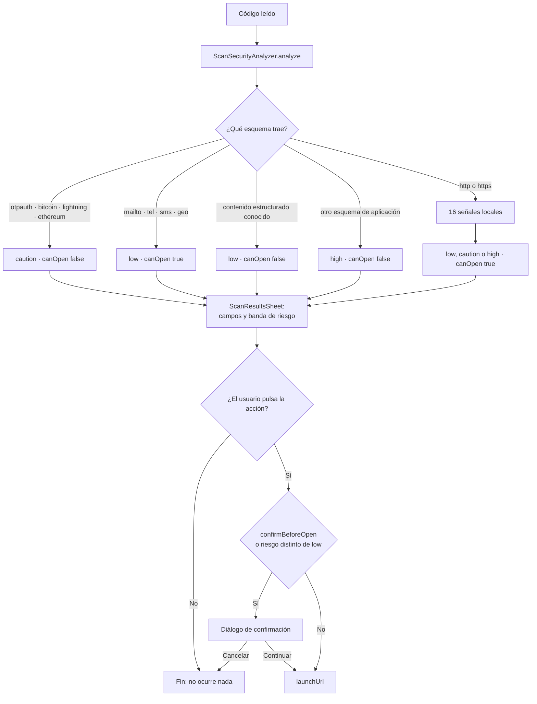

# 11 · Seguridad

Este documento enumera los controles de seguridad **presentes y ausentes**, y
describe los hallazgos sin publicar cadenas explotables. No se ejecutó ninguna
prueba destructiva ni ningún ataque contra sistemas externos: el análisis es de
código y de configuración.

La documentación previa de seguridad sigue siendo normativa y este documento la
complementa: [`../SECURITY.md`](../SECURITY.md),
[`../security/THREAT_MODEL.md`](../security/THREAT_MODEL.md),
[`../security/MASVS_CHECKLIST.md`](../security/MASVS_CHECKLIST.md) y
[`../security/SECURITY_TEST_PLAN.md`](../security/SECURITY_TEST_PLAN.md).

## Conclusión primero

La superficie de ataque de esta aplicación es **pequeña por construcción**: no
hay red saliente propia, no hay servidor, no hay cuentas y no hay ejecución de
código de terceros. Lo que queda son cuatro superficies reales —el contenido de
un código escaneado, un archivo importado, el almacenamiento local y las
aplicaciones externas a las que se delega una acción— y las cuatro tienen
controles explícitos.

Los tres controles criptográficos centrales están **bien construidos y
probados**: la llave ausente no se regenera, la rotación limpia su propia
basura, y la migración verifica antes de borrar. Las carencias principales no
están en la criptografía sino en dos asimetrías de aplicación de política —el
inventario no filtra contenido sensible; la exportación sale en claro sin
advertencia en la propia interfaz— y en que las acciones de GitHub no están
fijadas a SHA.

---

## 1 · Activos que se protegen

Tomados de [`../security/THREAT_MODEL.md`](../security/THREAT_MODEL.md) y
verificados contra el código:

| Activo | Dónde vive | Protección |
|---|---|---|
| Historial de lecturas | Sembast `scan_history` | AES-256-GCM por registro |
| Sesiones de inventario | Sembast `inventory_sessions` | AES-256-GCM por registro |
| Contraseñas Wi-Fi leídas | En memoria, durante la sesión | No se persisten desde el escáner; enmascaradas en pantalla |
| Semillas OTP | Idem | Idem |
| Datos de pago (EMVCo, SEPA, Swiss QR) | Idem | Idem |
| Identificación AAMVA | Idem | Idem |
| Llave de cifrado | Keychain / Keystore | `flutter_secure_storage`; nunca se exporta |
| Archivos exportados | Fuera de la aplicación | **Ninguna**: salen en claro por decisión del usuario |

---

## 2 · Criptografía

### Lo que se usa

| Aspecto | Valor | Evidencia |
|---|---|---|
| Algoritmo | AES-256-GCM (cifrado autenticado) | `AesGcm.with256bits()` en `payload_cipher.dart` |
| Biblioteca | `cryptography 2.9.0` | `pubspec.yaml` |
| Generación de llave | `algorithm.newSecretKey()` de la propia biblioteca | `SecureStorageKeyProvider.readOrCreate` |
| Nonce | Lo genera `cryptography` por operación y se guarda en el sobre | `SecretBox.nonce` |
| Autenticación | MAC de GCM, guardado en el sobre | `SecretBox.mac.bytes` |
| Codificación | Base64 para nonce, texto cifrado y MAC | `base64Encode` |

**No hay criptografía escrita a mano.** `grep -rn "Random(" lib` no devuelve
nada: no existe ninguna generación de aleatoriedad propia que pudiera ser débil.
La única generación de material criptográfico pasa por `newSecretKey()`.

`crypto 3.0.7` se usa solo para **SHA-256 y SHA-1 de identificadores**, nunca
para proteger nada:

| Uso | Algoritmo | Para qué |
|---|---|---|
| `ScanRecord.id` | SHA-256 truncado a 20 | Identificador único de registro |
| `InventorySession.id` | SHA-1 truncado a 16 | Identificador único de sesión |
| `RecoveryIssue.id` | SHA-256 truncado a 24 | Deduplicación determinista de incidencias |

El SHA-1 de `InventorySession.id` **no es un problema de seguridad**: la entrada
incluye `microsecondsSinceEpoch`, y el valor es un identificador local, no una
firma ni un control de integridad. Aun así, usar dos funciones hash distintas
para el mismo propósito en dos modelos hermanos es una inconsistencia. R-31.

### Las tres propiedades que hay que proteger

Son las que sostienen todo lo demás. Las tres tienen prueba dedicada.

**1 · Una llave ausente nunca se regenera en silencio.**

`decryptJson` registra el `keyId` en `_missingKeyIds` al no encontrar la llave, y
`encryptJson` **comprueba ese mismo conjunto antes de cifrar**. Sin la segunda
mitad, un descifrado fallido seguido de cualquier escritura llamaría a
`readOrCreate`, crearía una llave nueva bajo el mismo identificador y dejaría los
datos antiguos irrecuperables **incluso si la llave original reapareciera**.

Prueba: `test/core/payload_cipher_test.dart`, «a missing decryption key is never
replaced silently».

**2 · Una rotación fallida no deja material huérfano.**

`rotateEncryptionKey` precalcula todos los sobres, escribe registros y metadatos
en una sola transacción, y solo entonces activa la llave en memoria. Si algo
falla, el `catch` llama a `forgetKey(keyId)` dentro de un `try` anidado que no
oculta el error original.

Prueba: `test/core/data_maintenance_test.dart`, «failed rotation removes a newly
generated orphan key».

**3 · La manipulación del texto cifrado se rechaza.**

GCM autentica: alterar un solo bit del `cipherText` hace fallar la validación del
MAC. Prueba: `test/core/payload_cipher_test.dart`, «tampered authenticated
ciphertext is rejected».

Y dos rechazos explícitos más, ambos probados: una versión de sobre superior a la
conocida (`FormatException`) y un algoritmo distinto de `AES-256-GCM`
(`FormatException`). Es la política correcta —rechazar en vez de intentar
interpretar— y está recogida como compromiso en
[`../quality/COMPATIBILITY_CONTRACT.md`](../quality/COMPATIBILITY_CONTRACT.md).

### Lo que queda en claro, y por qué

| Dato | Dónde | Motivo |
|---|---|---|
| `id` del registro | Clave de Sembast | Necesario para direccionar |
| `scannedAt` / `createdAt` | Campo del registro | Necesario para ordenar (`SortOrder`) y podar (`Filter.lessThan`) sin descifrar 5 000 registros |
| Cabecera del sobre (`version`, `algorithm`, `keyId`, `createdAt`) | Dentro del `payload` | Sin ella no se podría decidir cómo descifrar |
| Todo `recovery_issues` salvo `encryptedPayload` | Almacén propio | Solo metadatos técnicos |
| Las 22 claves de preferencias | `SharedPreferences` | Son decisiones del usuario, no datos escaneados |

**Consecuencia para una auditoría**: con acceso al archivo de base de datos pero
sin la llave, un atacante conoce **cuántas lecturas hubo y cuándo**, y nada más
sobre su contenido. Es un metadato real y está documentado aquí porque no lo
estaba en ningún otro sitio del repositorio.

### Almacenamiento de la llave

`SecureStorageKeyProvider` usa `const FlutterSecureStorage()` **sin opciones
explícitas**: no se pasan `AndroidOptions` ni `IOSOptions`. Comprobado con
`grep`: no aparecen en `lib/`. Se aceptan por tanto los valores por defecto de
`flutter_secure_storage 10.3.1`.

*Inferencia basada en el código*: en esa serie del plugin el respaldo por defecto
de Android es `EncryptedSharedPreferences` y el de Apple el Keychain con la
accesibilidad por defecto. **Requiere validación** en dispositivo, porque el
comportamiento exacto depende de la versión del plugin y del sistema. Lo que sí
está fijado desde el repositorio es `android:allowBackup="false"`, aplicado por
`tool/bootstrap.py`, que impide que el sistema restaure una copia sin el material
criptográfico compatible.

En la **web**, `flutter_secure_storage` no dispone de un almacén protegido por el
sistema operativo: su implementación depende del origen del navegador.
`docs/SECURITY.md` ya lo advierte. **Requiere validación** el comportamiento
concreto de la PWA publicada; es la plataforma con la garantía más débil.

---

## 3 · Autenticación local

No hay autenticación remota porque no hay servidor. Lo que existe es un bloqueo
local opcional.

| Aspecto | Comportamiento |
|---|---|
| Activación | Ajustes → «Bloqueo de la aplicación» |
| Requisito para activar | `isDeviceSupported()` **y** una autenticación correcta en ese mismo momento |
| Momento de bloqueo | `inactive`, `paused`, `hidden` o `detached` |
| Momento de desbloqueo | Al volver, con `authenticate()` |
| Fallo de plataforma | `catch` → `false` → **no autenticado** |
| Bandera del plugin | `persistAcrossBackgrounding: true` |

Dos decisiones acertadas:

**No se puede activar a ciegas.** `_changeBiometricLock` exige una autenticación
correcta antes de guardar el ajuste. Si el dispositivo no lo admite o la persona
cancela, el ajuste no cambia y se muestra «No se pudo activar el bloqueo en este
dispositivo». Nadie se queda fuera de su propia aplicación.

**Cualquier fallo se resuelve como «no autenticado».** Ambos métodos de
`BiometricService` capturan `on Object` y devuelven `false`. Es la dirección
correcta para un control de seguridad.

### Límites del bloqueo

- **No cifra nada adicional.** La llave AES vive en el almacén seguro
  independientemente de si el bloqueo está activo. Alguien con acceso al
  dispositivo desbloqueado y a las herramientas adecuadas no se topa con este
  control.
- **`didUpdateWidget` desbloquea si el ajuste se apaga**
  (`if (!widget.settings.value.biometricLock) _unlocked = true;`). Es coherente,
  pero significa que apagar el ajuste surte efecto inmediato sin reautenticar.
- **No hay reintento limitado ni bloqueo temporal**: eso lo gestiona el diálogo
  del sistema, no la aplicación.

---

## 4 · Validación de entrada

### 4.1 Contenido de un código escaneado

Es la entrada menos confiable de todas: un código lo puede escribir cualquiera.

| Control | Dónde |
|---|---|
| Ninguna acción se ejecuta automáticamente | `_openRecord` exige pulsación explícita |
| Bloqueo de esquemas de aplicación no permitidos | `analyze`, rama 4: cualquier esquema que no sea `http`, `https`, `mailto`, `tel`, `sms`, `smsto` o `geo` produce `high` y `canOpen: false` |
| 16 señales locales sobre URL | `analyze`, ramas 1 a 16 |
| Confirmación obligatoria con riesgo distinto de `low` | `shouldConfirm` es una disyunción entre el ajuste y el nivel |
| El intérprete nunca lanza | Todas las ramas devuelven; la última es `ContentKind.text` |
| El TLV de EMVCo se detiene en vez de fallar | `_tlv` hace `break` ante un campo mal formado |

La prueba `test/scan_security_analyzer_test.dart` incluye un caso con un esquema
de aplicación activo y verifica `high` y `canOpen: false`. Esa es la defensa
concreta contra un código que intente inyectar un esquema ejecutable.

**Lo que el analizador no hace, y está declarado**: no consulta reputación
remota, no valida certificados, no sigue redirecciones y **nunca declara que un
enlace sea seguro**. Su nivel más bajo se llama literalmente «Sin señales
evidentes».

### 4.2 Archivo JSON importado

Seis puertas antes de que un byte llegue a la base de datos. Detalle en
[08-data-flow.md](08-data-flow.md):

| Puerta | Límite | Ataque que mitiga |
|---|---|---|
| Tamaño | 25 MB | Agotamiento de memoria |
| Profundidad | 32 por rama | Desbordamiento de pila al recorrer |
| Nodos | 100 000 | Agotamiento de CPU y memoria |
| Procedencia | `application` y `type` exactos | Importar un JSON de otra aplicación |
| Versión de esquema | `≤ 2` | Interpretar un formato futuro desconocido |
| Cantidad | 5 000 registros / 10 000 productos | Agotamiento |

`_validateJsonShape` usa **una pila explícita, no recursión**: es lo que permite
que la comprobación de profundidad se ejecute antes de que el propio recorrido
desborde. Hay prueba dedicada en `test/services/import_service_test.dart`
(«excessively deep JSON is rejected before persistence»).

Además, **nada se escribe hasta que el usuario elige una estrategia**: la vista
previa muestra válidos, duplicados y rechazados y la base sigue intacta.

### 4.3 Entrada de teclado

`trim()` en notas, etiquetas, nombres de sesión y notas de producto; las
etiquetas se deduplican con `toSet()`. No hay inyección posible: **no hay SQL, no
hay plantillas, no hay `eval`, no hay HTML renderizado desde datos del usuario**.
Todo se muestra con widgets `Text` y `SelectableText`, que no interpretan marcado.

---

## 5 · Privacidad

| Control | Implementación | Verificado por |
|---|---|---|
| Cero telemetría | Ninguna dependencia de analítica; ningún cliente de red | `grep` sobre `pubspec.yaml` y `lib/` |
| El diagnóstico no puede filtrar datos | `AppDiagnostics.record` acepta un `Object` y guarda `runtimeType`, no el mensaje | `test/core/diagnostics_test.dart` |
| El paquete de recuperación no lleva llaves | Los sobres salen cifrados | `test/core/recovery_service_test.dart` |
| OTP y Wi-Fi con contraseña fuera del historial | `_persistAndShow` filtra por `isSensitive` | Ver la excepción en el apartado 7 |
| Enmascarado en pantalla | Cinco nombres de campo, con botón para revelar | — |
| Portapapeles con borrado programado | `ClipboardService.copy`, comprobando que el valor no haya cambiado | — |
| Sesión privada | `private_mode` desactiva toda persistencia del escáner | — |
| Prohibición de registrar cargas | `avoid_print` más `check_sensitive_logging` en el validador | `grep -rn "print(" lib` devuelve `0` |

`check_sensitive_logging` de `tool/validate_structure.py` es un gate real: falla
la validación si algún `print`, `debugPrint` o `log` recibe un argumento que
contenga `rawValue`, `password`, `secret`, `otp` o `payload`.

---

## 6 · Permisos y superficie de plataforma

### Android

| Permiso | Declarado por | Por qué |
|---|---|---|
| `android.permission.CAMERA` | `tool/bootstrap.py` | Lectura con cámara |
| `android.permission.USE_BIOMETRIC` | idem | Bloqueo de la aplicación |
| `android.hardware.camera.any` con `required="false"` | idem | Permite instalar sin cámara |

No se piden `INTERNET`, `READ_EXTERNAL_STORAGE`, `WRITE_EXTERNAL_STORAGE`,
`ACCESS_FINE_LOCATION` ni ningún otro. **La ausencia de `INTERNET` en el
manifiesto principal es la comprobación más contundente de que no hay red
saliente propia**: aunque alguien añadiera un cliente HTTP, la aplicación no
tendría permiso para usarlo.

*Nota*: Flutter añade `INTERNET` al manifiesto de **depuración**
(`android/app/src/debug/AndroidManifest.xml`) para el conector del depurador. El
manifiesto principal, que es el que se compila en release, no lo declara.

`android:allowBackup="false"` bloquea la restauración automática.

### Apple

| Clave | Texto |
|---|---|
| `NSCameraUsageDescription` | «La cámara se utiliza para leer códigos QR y códigos de barras.» |
| `NSPhotoLibraryUsageDescription` | «La galería se utiliza para analizar códigos presentes en imágenes seleccionadas.» |
| `NSFaceIDUsageDescription` | «Face ID protege el acceso a la aplicación cuando el usuario activa el bloqueo.» |

Entitlements de macOS: `com.apple.security.device.camera`,
`com.apple.security.files.user-selected.read-only` y `keychain-access-groups`
vacío. El acceso a archivos es **solo lectura y solo de lo que el usuario
seleccione**.

Todo esto lo aplica `tool/bootstrap.py`. Como las carpetas nativas no se
versionan, **la única fuente de verdad de estos permisos es ese script**.

### Web y PWA

La PWA hereda el modelo de permisos del navegador: la cámara exige un gesto del
usuario y un origen seguro. La lectura de PDF **no está disponible**
(`pdf_page_renderer_stub.dart` lanza `UnsupportedError` y el menú se deshabilita
con `enabled: !kIsWeb`).

`docs/SECURITY.md` exige publicar la PWA solo por HTTPS con HSTS y cabeceras
adecuadas. GitHub Pages sirve por HTTPS; **no se identificó** ninguna
configuración de CSP ni de cabeceras de seguridad en `landing/` ni en el
workflow. R-32.

---

## 7 · Hallazgos de seguridad

Descritos sin cadenas explotables. Todos están además en
[15-risks-and-technical-debt.md](15-risks-and-technical-debt.md) con severidad,
probabilidad y prioridad.

### S-1 · El inventario persiste contenido sensible (R-03)

**Severidad**: media. **Evidencia**: `InventoryScreen._onDetect` llama a
`widget.store.addScan(record)` sin comprobar `record.isSensitive`, y
`InventoryStore.addScan` indexa el ítem por `record.rawValue`.

Un QR de Wi-Fi con contraseña, un OTP o un QR de pago escaneado dentro de una
sesión de inventario **se persiste**, con su texto íntegro como clave del ítem.
Va cifrado igual que todo lo demás, así que no es una fuga hacia el disco en
claro, pero **contradice** el punto 5 de `docs/SECURITY.md` («No persistir
automáticamente OTP ni Wi-Fi con contraseña») y la política de privacidad.

Además, ese texto sale **en claro** al exportar la sesión a CSV, XLSX o JSON.

### S-2 · La exportación sale en claro sin advertencia en la interfaz (R-27)

**Severidad**: media. **Evidencia**: `ExportService` no cifra nada; las entradas
del menú se llaman «Exportar CSV», «Exportar JSON» y «Exportar Excel XLSX», y no
muestran ningún diálogo.

Compartir un registro **individual** que sea sensible sí abre un diálogo de
advertencia. Exportar **todo el historial** no. La advertencia existe solo en
`docs/SECURITY.md`, que quien usa la aplicación no lee.

### S-3 · Las acciones de GitHub no están fijadas a SHA (R-33)

**Severidad**: media para la cadena de suministro. **Evidencia**: los 13 `uses:`
de los dos workflows apuntan a etiquetas móviles (`actions/checkout@v7`,
`subosito/flutter-action@v2` y similares), no a un SHA de commit.

Una etiqueta puede reapuntarse. Un compromiso de cualquiera de esos repositorios
ejecutaría código arbitrario en el runner que compila los APK publicados.
Mitigación parcial ya presente: `permissions: contents: read` en el trabajo de
calidad, y `deploy-landing.yml` limita sus permisos a `pages: write` e
`id-token: write`.

### S-4 · Los APK publicados van firmados con la clave de depuración

**Severidad**: alta para la distribución, **ya declarada**. `README.md`,
`docs/RELEASE.md` e `IMPLEMENTATION_STATUS.md` lo dicen con claridad, incluido
que una versión futura firmada con clave propia **no podrá actualizarlos**.

Se registra aquí por completitud: cualquiera puede compilar un APK con esa misma
clave conocida. La verificación real la aporta el SHA-256 publicado junto a cada
artefacto, no la firma.

### S-5 · Las llaves antiguas no se borran tras rotar (R-20)

**Severidad**: baja. **Evidencia**: `rotateEncryptionKey` no llama a `forgetKey`
sobre la llave anterior en el camino de éxito.

Es prudente —permite recuperar un registro que se hubiera quedado atrás— pero
significa que el almacén seguro acumula una entrada por rotación y que material
criptográfico capaz de descifrar datos antiguos permanece en el dispositivo
indefinidamente.

### S-6 · Los PNG temporales del PDF son datos en claro en disco

**Severidad**: baja, **riesgo aceptado**. `PdfPageRenderer` escribe cada página
como PNG en el directorio temporal para poder pasar una ruta al motor de lectura.
La limpieza cubre los tres caminos de salida —éxito, error y cancelación— y es
idempotente. La ventana de exposición es la duración del análisis.

### S-7 · La lista de campos enmascarados es literal (R-19)

**Severidad**: baja. Cinco nombres: `Contraseña`, `Secreto`, `Dirección`,
`IBAN`, `Carga`. Un parser nuevo que produjera un campo sensible con otro nombre
**no se enmascararía**, aunque el registro estuviera marcado como sensible.

### S-8 · `legacyKeyId` y `currentKeyId` valen lo mismo (R-13)

**Severidad**: baja hoy, **alta si alguien cambia `currentKeyId`**. Ambas
constantes valen `'v2'`. Cambiar la primera sin cambiar la segunda rompería
silenciosamente la lectura de los sobres heredados.

### S-9 · Sin CSP ni cabeceras de seguridad declaradas para la PWA (R-32)

**Severidad**: baja. **No identificado**: no hay archivo de cabeceras, ni meta
CSP en `landing/index.html`, ni paso en el workflow que las añada. GitHub Pages
no permite cabeceras personalizadas, así que la mitigación tendría que ser una
meta `Content-Security-Policy` en el propio HTML. `docs/SECURITY.md` lo pide y
no está.

---

## 8 · Controles ausentes

Enumerarlos es tan importante como enumerar los presentes.

| Control ausente | ¿Es un problema? |
|---|---|
| Certificate pinning | **No**: no hay conexiones propias que fijar |
| Detección de root o jailbreak | No implementado. **No documentado en el repositorio** como decisión |
| Ofuscación del código Dart | No se usa `--obfuscate`. Un APK release es descompilable |
| Detección de depurador o anti-tampering | No implementado |
| `FLAG_SECURE` contra capturas de pantalla | **No implementado**: una captura del selector de aplicaciones puede mostrar una contraseña Wi-Fi en pantalla. `MASVS_CHECKLIST.md` lo lista como pendiente de validar en dispositivo |
| Bloqueo tras N intentos fallidos | Lo gestiona el sistema, no la aplicación |
| Borrado seguro de memoria | Dart no lo permite; las llaves quedan en el montón hasta la recolección |
| Auditoría de seguridad independiente | **No realizada**. Declarado en `MASVS_CHECKLIST.md` |
| Escaneo de dependencias por CVE | No hay paso de CI que lo haga. Sí hay SBOM e inventario de licencias |
| Firma de publicación | Fuera del alcance de 1.1.0 |

La ausencia de `FLAG_SECURE` merece atención: la aplicación muestra contraseñas
Wi-Fi y secretos OTP en pantalla —tras pulsar el ojo— y sin esa bandera esas
pantallas aparecen en la vista de aplicaciones recientes de Android.

---

## 9 · Cadena de suministro

| Control | Estado |
|---|---|
| `pubspec.lock` versionado | **Sí** |
| Versiones exactas en `pubspec.yaml` | **Sí**: las 19 dependencias directas usan versión exacta, sin `^` |
| SBOM CycloneDX | **Sí**: `docs/security/sbom-source.cdx.json` versionado, más uno resuelto en cada CI |
| Inventario de licencias | **Sí**: `tool/generate_license_inventory.py`, en cada CI |
| Manifiesto de fuente con SHA-256 | **Sí**: `SOURCE_MANIFEST.json`, 150 archivos |
| Checksums de los artefactos publicados | **Sí**: `checksums.txt` en el release |
| Dependabot | **Sí**: pub semanal, acciones mensual |
| Acciones fijadas a SHA | **No** (S-3) |
| Escaneo de CVE en CI | **No identificado** |

El uso de versiones **exactas** en `pubspec.yaml` es una decisión de seguridad
poco frecuente y merece reconocerse: `audioplayers: 6.8.1`, no `^6.8.1`.
Combinado con el lockfile versionado, hace que dos compilaciones del mismo commit
resuelvan el mismo grafo.

`tool/generate_sbom.py` declara honestamente su cobertura: si Flutter está
disponible produce un SBOM `resolved-transitive`; si no, uno
`declared-direct-only` marcado como tal en `metadata.properties`. No infla la
cobertura.

---

## 10 · Barrido de secretos

Ejecutado sobre todo el árbol versionado, excluyendo `build/`:

```bash
grep -rnEi "(sk-|ghp_|gho_|AKIA|BEGIN [A-Z ]*PRIVATE KEY)" \
  --include="*.dart" --include="*.md" --include="*.json" \
  --include="*.yaml" --include="*.yml" --include="*.py" .
```

**Sin resultados.** Tampoco hay archivos `.env`, `.p12`, `.jks`, `.keystore` ni
`.pem` en el repositorio. Los dos workflows **no consumen ningún secreto de
GitHub**: no aparece ninguna referencia a `secrets.` en ellos.

Los valores de ejemplo del código son ficticios y usan dominios reservados:
`https://example.com` en el generador, `correo@example.com`, y números de
teléfono con prefijo chileno inventados.

---

## 11 · Flujo de decisión de seguridad



**Lo que muestra**: que hay dos puertas antes de cualquier acción externa —una
decisión del usuario y, casi siempre, un diálogo— y que el nivel de riesgo puede
imponer el diálogo aunque el usuario lo haya desactivado.

**Lo que no muestra**: que el paso `launchUrl` delega en el sistema operativo, y
que a partir de ahí la seguridad depende de la aplicación que el sistema elija.
Tampoco muestra el camino de compartir, que exige diálogo solo para registros
sensibles.

---

## 12 · Recomendaciones, por prioridad

Informativo. **Ninguna se aplicó en este trabajo**: ver la nota de alcance en
[15-risks-and-technical-debt.md](15-risks-and-technical-debt.md).

| # | Recomendación | Esfuerzo estimado |
|---|---|---|
| 1 | Aplicar el filtro `isSensitive` también en `InventoryScreen._onDetect`, o declarar la excepción en `docs/SECURITY.md` | 1 línea más una decisión de producto |
| 2 | Añadir un diálogo de advertencia antes de exportar historial o inventario | ~30 líneas |
| 3 | Fijar las 13 acciones de GitHub a SHA de commit | 30 minutos |
| 4 | Añadir `FLAG_SECURE` en Android para las pantallas que muestran secretos | Requiere canal de plataforma |
| 5 | Borrar la llave anterior tras una rotación confirmada, o documentar por qué no | 3 líneas más una decisión |
| 6 | Añadir una meta `Content-Security-Policy` a `landing/index.html` | 1 línea |
| 7 | Añadir un paso de CI que compare el SBOM contra una base de CVE | Media jornada |
| 8 | Separar `legacyKeyId` en una constante distinta y documentada | 2 líneas |

---

Continúa en [12 · Pruebas y calidad](12-testing-and-quality.md).
