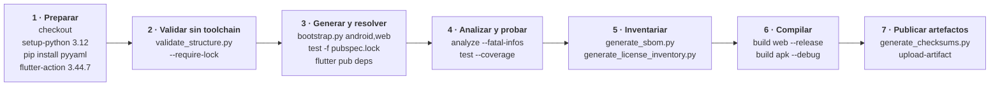
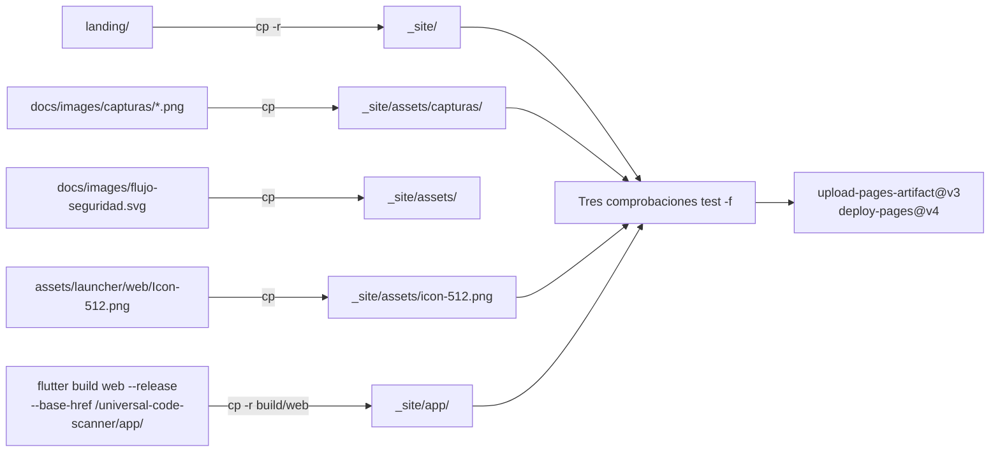

# 13 · Despliegue y operación

## Qué se despliega, exactamente

Este proyecto produce **tres artefactos distintos**, y solo uno de ellos se
despliega automáticamente.

| Artefacto | Cómo se publica | Automático |
|---|---|---|
| **APK de Android** | GitHub Releases, con `checksums.txt` | **No**: proceso manual |
| **Landing + PWA** | GitHub Pages | **Sí**: `deploy-landing.yml` |
| **Documentación** | El propio repositorio | No aplica |

No hay servidor que operar, no hay base de datos que administrar y no hay
secretos de producción que rotar: **los dos workflows no consumen ningún secreto
de GitHub**.

---

## 1 · Integración continua

### `.github/workflows/flutter-ci.yml`

| Aspecto | Valor |
|---|---|
| Nombre | `Flutter quality and compatibility` |
| Disparadores | `push` a `main` y `develop`, cualquier `pull_request`, `workflow_dispatch` |
| Permisos | `contents: read` |
| Variable | `FLUTTER_VERSION: 3.44.7` |
| Trabajos | `quality` (ubuntu-latest) y `apple` (macos-latest) |

#### Trabajo `quality`



**Lo que muestra**: el orden real de los pasos y que la validación estructural va
**antes** de generar plataformas, para fallar rápido y sin toolchain.

**Lo que no muestra**: que `bootstrap.py` es imprescindible aquí porque
`android/` y `web/` no están versionados. Sin ese paso, `flutter build` no
tendría a qué apuntar. Tampoco muestra que el APK que se compila es **de
depuración**: los APK de release se compilan a mano al publicar.

Artefactos subidos: el APK de depuración, `build/web`, el SBOM, el inventario de
licencias, `build/checksums.txt`, `coverage/lcov.info`, `pubspec.lock` y
`test_assets/manifest.json`.

#### Trabajo `apple`

Tres pasos reales: `bootstrap.py --platforms ios,macos`,
`flutter build ios --release --no-codesign` y `flutter build macos --release`.

La prueba de integración **se omite a propósito**, con el motivo escrito como
comentario en el propio archivo: los runners macOS de GitHub no tienen sesión
gráfica interactiva, así que la aplicación arranca sin llegar a establecer la
conexión de depuración. Para ejecutarla en local:

```bash
flutter test integration_test/app_launch_test.dart -d macos
```

Es un ejemplo de **degradación declarada en vez de silenciosa**, y conviene
conservarlo.

---

## 2 · Publicación de la landing y la PWA

### `.github/workflows/deploy-landing.yml`

| Aspecto | Valor |
|---|---|
| Disparadores | `push` a `main` **filtrado por rutas**, más `workflow_dispatch` |
| Permisos | `contents: read`, `pages: write`, `id-token: write` |
| Concurrencia | Grupo `pages`, sin cancelar en curso |
| Tiempo máximo | 30 minutos |
| `APP_BASE_HREF` | `/universal-code-scanner/app/` |

Rutas que lo disparan: `landing/**`, `lib/**`, `web/**`, `assets/**`,
`docs/images/**`, `pubspec.yaml`, `pubspec.lock`, `tool/bootstrap.py` y el propio
workflow.

**Hallazgo**: el filtro `web/**` **no puede dispararse nunca**, porque `/web/`
está en `.gitignore` y no hay ningún archivo versionado bajo esa ruta. Es un
filtro inerte. R-12.

**Consecuencia práctica de esta lista**: este trabajo de documentación toca
`docs/system-documentation/**` y `README.md`, ninguno de los cuales está en el
filtro. **El commit de documentación no disparará la publicación de la landing**,
solo `flutter-ci.yml`.

### Cómo se monta el sitio



**Lo que muestra**: que las imágenes **no se duplican** en `landing/`. Viven una
sola vez en el repositorio y se copian al artefacto durante la publicación.

**Lo que no muestra**: la consecuencia de esa decisión, que sí explica
[`../../landing/README.md`](../../landing/README.md): al abrir `landing/index.html`
directamente desde el disco, **las capturas, el diagrama y el enlace a `/app/`
aparecen rotos**. Para verlo en local hay que reproducir el montaje, y ese
archivo trae el guion exacto.

Las tres comprobaciones `test -f` al final del paso de montaje son un gate real:
si falta `_site/app/index.html`, `_site/assets/capturas/escanear.png` o
`_site/assets/icon-512.png`, el workflow falla antes de publicar. Es lo que
impide publicar un sitio a medias.

### Direcciones publicadas

| Ruta | Contenido |
|---|---|
| `https://vladimiracunadev-create.github.io/universal-code-scanner/` | La landing |
| `.../universal-code-scanner/app/` | La PWA en release |

`touch _site/.nojekyll` desactiva el procesado de Jekyll, necesario porque el
build de Flutter genera carpetas que empiezan por guion bajo.

---

## 3 · Publicación de un release de Android

**Proceso manual.** No hay workflow que lo haga. La lista completa de lo que
haría falta para llegar a las tiendas está en
[`../RELEASE.md`](../RELEASE.md) y **está fuera del alcance de 1.1.0**.

El procedimiento que se siguió para 1.1.0, reconstruido desde
[`../../VALIDATION.md`](../../VALIDATION.md) y `RELEASE_SOURCE.json`:

```bash
# 1 · Puerta de estabilidad completa
./tool/finalize_stable.sh

# 2 · Los cuatro APK
flutter build apk --release --split-per-abi
flutter build apk --release

# 3 · Checksums
python3 tool/generate_checksums.py \
  build/app/outputs/flutter-apk/*.apk > checksums.txt

# 4 · Manifiesto de fuente
python3 tool/generate_source_manifest.py

# 5 · Publicación
gh release create v1.1.0 build/app/outputs/flutter-apk/*.apk checksums.txt
```

`tool/finalize_stable.sh` encadena: comprobar que `flutter` existe,
`flutter --version`, `pub get`, comprobar `pubspec.lock`, `analyze`, `test`,
`build apk --debug`, `build web --release`, `validate_structure.py
--require-lock`, SBOM, inventario de licencias, manifiesto de fuente, y termina
con un `git diff -- pubspec.lock pubspec.yaml` y el recordatorio de revisar y
confirmar el lockfile antes de etiquetar.

### Artefactos de 1.1.0 y sus tamaños

| Archivo | Para quién | Tamaño |
|---|---|---|
| `app-arm64-v8a-release.apk` | Prácticamente cualquier móvil actual | 32,8 MB |
| `app-armeabi-v7a-release.apk` | Móviles antiguos de 32 bits | 26,8 MB |
| `app-x86_64-release.apk` | Emuladores y equipos x86 | 35,3 MB |
| `app-release.apk` | Universal | 88,1 MB |

Valores tomados de `RELEASE_SOURCE.json`, campo
`runtimeValidation.androidReleaseApk`.

### La advertencia de firma

**Los cuatro APK van firmados con la clave de depuración de Android**
(`CN=Android Debug`). Sirven para instalar y probar. **No** sirven para Google
Play, y una versión futura firmada con una clave propia **no podrá
actualizarlos**: habrá que desinstalar antes.

Está declarado en `README.md`, en `docs/RELEASE.md` y en
`IMPLEMENTATION_STATUS.md`. La verificación real de un artefacto descargado es su
**SHA-256**, publicado en `checksums.txt`, no la firma.

---

## 4 · Generación de los PDF de esta documentación

`tool/build_system_documentation_pdf.py` produce un PDF por documento más uno
consolidado, todos en `docs/system-documentation/pdf/`. **El Markdown es la
fuente única**: el script no mantiene una segunda versión del texto.

### Uso

```bash
# Todos los documentos más el consolidado
python tool/build_system_documentation_pdf.py

# Solo uno, para iterar rápido sobre el formato
python tool/build_system_documentation_pdf.py --only 03-architecture.md

# Sin el consolidado
python tool/build_system_documentation_pdf.py --skip-combined
```

### Dependencias

| Dependencia | Obligatoria | Si falta |
|---|---|---|
| `markdown` | **Sí** | El script se detiene con la instrucción de instalación |
| `xhtml2pdf` | **Sí** | Idem |
| `mmdc` (`@mermaid-js/mermaid-cli`) | No | Los diagramas se incluyen como bloque de texto monoespaciado y **se avisa por consola** |

```bash
python -m pip install markdown xhtml2pdf
npm install -g @mermaid-js/mermaid-cli   # opcional, para los diagramas
```

Los diagramas se rasterizan a PNG y **se cachean por hash de su código fuente**
en `docs/system-documentation/pdf/.mermaid-cache/`, así que una segunda ejecución
solo rehace lo que cambió. Esa carpeta está en `.gitignore`.

### Qué lee del repositorio

| Dato de la portada | De dónde sale |
|---|---|
| Versión | `version:` de `pubspec.yaml` |
| Commit | `git rev-parse --short HEAD` |
| Fecha | `date.today()` |

**Ninguno se escribe a mano.** Una portada con números manuales queda obsoleta en
el primer commit.

### Salida

Al terminar informa cuántos diagramas se renderizaron y cuántos degradaron a
texto, y falla con código distinto de cero si algún PDF quedó de 0 bytes. La
degradación **nunca es silenciosa**.

---

## 5 · Otras herramientas de operación

| Guion | Cuándo se ejecuta | Qué produce |
|---|---|---|
| `tool/bootstrap.py` | Tras clonar y en ambos workflows | `android/`, `ios/`, `web/`, `macos/` parcheados |
| `tool/validate_structure.py` | CI, puerta de calidad, publicación | Diez comprobaciones offline |
| `tool/run_quality_gate.sh` | Manual, antes de un commit grande | Validación, análisis, pruebas, SBOM |
| `tool/finalize_stable.sh` | Antes de etiquetar | Todo lo anterior más compilaciones y manifiesto |
| `tool/generate_sbom.py` | CI y publicación | `build/reports/sbom.cdx.json` |
| `tool/generate_license_inventory.py` | CI y publicación | `build/reports/dependency-licenses.json` |
| `tool/generate_source_manifest.py` | Publicación | `SOURCE_MANIFEST.json` |
| `tool/generate_checksums.py` | Publicación | SHA-256 de los artefactos |
| `tool/generate_launcher_icons.py` | Solo al cambiar la identidad visual | Los PNG de `assets/launcher/` |
| `tool/generate_scan_beep.py` | Solo al cambiar el tono | `assets/sounds/scan_success.wav` |

Los dos últimos son **regeneradores de recursos versionados**: su salida está en
el repositorio, así que compilar no los necesita. `generate_launcher_icons.py`
requiere Pillow; `generate_scan_beep.py` usa solo la biblioteca estándar.

`generate_source_manifest.py` **debe ejecutarse al final de cualquier cambio que
añada o modifique archivos versionados**, incluido este trabajo de documentación:
`SOURCE_MANIFEST.json` guarda el tamaño y el SHA-256 de cada fuente, y quedaría
desactualizado.

---

## 6 · Mantenimiento

### Dependencias

`.github/dependabot.yml` abre hasta 5 PR semanales para `pub` y actualiza las
acciones de GitHub mensualmente. Ignora explícitamente:

| Paquete | Versiones ignoradas | Motivo escrito en el propio archivo |
|---|---|---|
| `share_plus` | `>=13.0.0` | Exige `win32 ^6`, incompatible con el `win32 ^5.9` de `file_picker 11.x` |
| `pdfrx` | `>=2.4.6` | Arrastra `archive ^4`, incompatible con el `archive ^3.6.1` de `excel 4.0.6` |

**Antes de levantar cualquiera de esos dos topes hay que leer
[`../quality/LOCKFILE.md`](../quality/LOCKFILE.md).** Subirlos sin resolver antes
el conflicto rompe `pub get` por completo.

El punto 14 del contrato de compatibilidad exige actualizar las dependencias
**de forma individual**, con pruebas de regresión y posibilidad de reversión.

### Versión

Subir la versión implica **dos archivos a la vez**:

1. `pubspec.yaml`, campo `version`, con la forma `X.Y.Z+N`;
2. `lib/core/app_info.dart`, constante `appVersion`, con la parte `X.Y.Z`.

`tool/validate_structure.py::check_interface_version` **falla la validación si
divergen**. Esa comprobación nació de un defecto real: la pantalla «Acerca de»
mostraba `1.0.0` en la versión `1.1.0` porque el número estaba escrito como
literal en `settings_screen.dart` y nadie lo subió al publicar.

### Cadena de compilación de Android

`tool/bootstrap.py` fija AGP `8.11.1`, Kotlin `2.2.20` y Gradle `8.14.3`. El
motivo está escrito como comentario en el script y explicado en
[`../quality/LOCKFILE.md`](../quality/LOCKFILE.md). Revisar cuando los plugins
del conjunto publiquen versiones compatibles con el Kotlin integrado de AGP 9.

---

## 7 · Reversión

| Situación | Cómo se revierte | Riesgo |
|---|---|---|
| Un commit rompe la CI | `git revert <sha>` y push | Bajo |
| La landing publicada está rota | Revertir el commit y volver a lanzar `deploy-landing.yml` a mano | Bajo. La versión anterior sigue servida hasta que termine el despliegue nuevo |
| Un APK publicado tiene un fallo | Publicar un release nuevo. **No se puede retirar un APK ya descargado** | Medio |
| Una dependencia rompe la resolución | `git checkout -- pubspec.yaml pubspec.lock` y `flutter pub get` | Bajo |
| Un cambio del formato de cifrado deja datos ilegibles | **No hay reversión automática.** Los datos ya reescritos con el formato nuevo no vuelven solos | **Crítico** |

La última fila es la que importa. Un cambio en `PayloadCipher.currentVersion`,
`currentAlgorithm`, `currentKeyId` o `SecureStorageKeyProvider._prefix` **no es
reversible** una vez que la aplicación ha reescrito registros: la actualización
perezosa de sobres los habrá convertido al formato nuevo en la primera lectura.

Por eso el contrato de compatibilidad dedica sus ocho primeros puntos a los datos
del usuario, y por eso la rotación de llave verifica y limpia. Antes de tocar
esas cuatro constantes hay que leer
[`../quality/COMPATIBILITY_CONTRACT.md`](../quality/COMPATIBILITY_CONTRACT.md)
y [07-database.md](07-database.md).

---

## 8 · Operación en el dispositivo

No hay servidor, así que «operar» significa lo que el usuario puede hacer cuando
algo va mal. Las cuatro herramientas de recuperación:

| Herramienta | Dónde | Para qué |
|---|---|---|
| **Inicio seguro** | Automático si el arranque falla | Reintentar, abrir en modo temporal, restablecer preferencias visuales, copiar diagnóstico |
| **Modo temporal** | Desde el inicio seguro | Usar la aplicación con base en memoria, sin tocar los datos persistentes |
| **Centro de recuperación** | Ajustes → Datos y compatibilidad | Reintentar el descifrado, descartar un registro, marcar revisado, exportar el paquete |
| **Rotar llave de cifrado** | Ajustes → Datos y compatibilidad | Recifrar todo con una llave nueva |

El diagnóstico privado contiene **solo** tipo de error, área y huella de pila; el
texto bajo el botón lo enumera literalmente. El paquete de recuperación contiene
los sobres **todavía cifrados** y ninguna llave.

Detalle de cada síntoma en [14-troubleshooting.md](14-troubleshooting.md).

---

## 9 · Lista de comprobación antes de publicar

Reconstruida de `tool/finalize_stable.sh`, `docs/RELEASE.md` y la práctica
observable en `VALIDATION.md`:

- [ ] `flutter pub get` resuelve y `pubspec.lock` no cambia inesperadamente
- [ ] `python tool/validate_structure.py --require-lock` sin errores
- [ ] `flutter analyze --fatal-infos` sin hallazgos
- [ ] `flutter test` en verde
- [ ] `flutter build web --release` compila
- [ ] `flutter build apk --release --split-per-abi` y `--release` compilan
- [ ] La versión de `pubspec.yaml` y la de `app_info.dart` coinciden
- [ ] `CHANGELOG.md` describe los cambios de la versión
- [ ] `VALIDATION.md` y `RELEASE_SOURCE.json` reflejan lo verificado de verdad
- [ ] `python tool/generate_source_manifest.py` regenerado y confirmado
- [ ] `python tool/build_system_documentation_pdf.py` regenerado si la documentación cambió
- [ ] Checksums generados y publicados junto a los artefactos
- [ ] El tono de lectura está **dentro** del APK, no solo en el repositorio
- [ ] El APK descargado del release coincide con su SHA-256 publicado

Las dos últimas no son teóricas: se comprobaron para 1.1.0 y están registradas en
`VALIDATION.md`. Verificar que un recurso empaquetado llegó de verdad al artefacto
es el tipo de comprobación que separa un release correcto de uno que compila y
sale vacío.

`docs/RELEASE.md` es un documento de proceso del propio proyecto. **Se propone**
añadirle una línea para regenerar los PDF de esta documentación antes de
etiquetar; no se editó en este trabajo por ser un documento de decisión del
usuario.

---

Continúa en [14 · Solución de problemas](14-troubleshooting.md).
